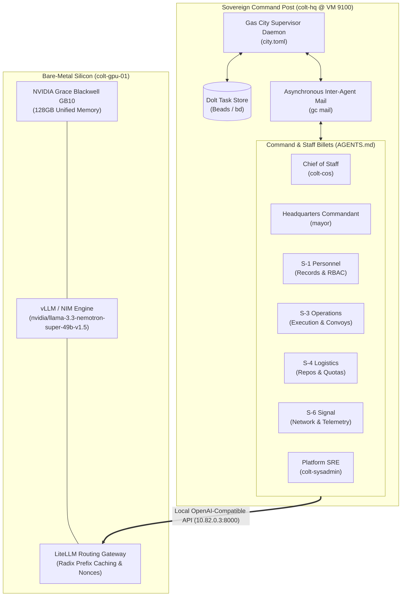

# Camp Colt

> **Sovereign AI Command Post & Multi-Agent Factory for Suitcase AI**
> Architected and operated by **Nick Chalko** ([showmetheinference.com](https://showmetheinference.com))

[](LICENSE)
[](docs/LOCAL_MODELS.md)
[](docs/TELEMETRY_32K_BASELINE.md)
[](city.toml)
[-red.svg>)](AGENTS.md)

---

## Executive Overview

After 18 years engineering distributed systems and core infrastructure at Google (Borg, Piper, Spanner), one engineering reality is clear: **syntax generation is solved; the real engineering frontier is deterministic multi-agent orchestration, local sovereign inference on bare metal, and empirical hardware sympathy.**

**Camp Colt** is the sovereign command post and AI agent factory powering **Suitcase AI**. Operating directly on bare-metal silicon in an on-premise command post (`colt-hq`), Camp Colt coordinates autonomous specialist agents to execute complex software engineering, systems administration, and telemetry research without relying on commercial cloud APIs.

Every operational milestone in Camp Colt generates empirical receipts—verifiable timeseries telemetry, reproducible configurations, and rigorous architectural dossiers—feeding directly into deep-dive public essays on [showmetheinference.com](https://showmetheinference.com).



---

## Core Architectural Pillars

### 1. Inference Engineering & Hardware Sympathy

Camp Colt treats neural inference as a disciplined systems engineering problem rather than a generic API call:

- **Bare-Metal Silicon:** Primary inference executes on an ASUS Ascent GX10 equipped with an NVIDIA Grace Blackwell GB10 running 128GB of high-bandwidth unified memory (`10.82.0.3:8000`).
- **Primary Foundation Model:** NVIDIA Llama-3.3 Nemotron Super 49B (`nvidia/llama-3.3-nemotron-super-49b-v1.5`), offering state-of-the-art reasoning, tool calling, and code generation locally.
- **Gateway & Prefix Caching:** The LiteLLM gateway (`docs/LITELLM_GATEWAY_ARCHITECTURE.md`) enforces cold-cache randomized UUID nonces, alternating query order, and warm trimmed-mean benchmarking. Verified direct-to-proxy overhead is nominal at **+9.5 ms**.
- **Role-Differentiated Reasoning:** Reasoning effort is dynamically tuned by agent role (`docs/ROLE_DIFFERENTIATED_REASONING_EFFORT.md`):
  - `none`: Fast operational dispatchers and tool routers (`local-fast`).
  - `medium`: Review synthesizers and general task executors (`local-general`).
  - `high`: Deep architecture, complex bug remediation, and multi-file code synthesis (`local-coder`).
- **Streaming Tool-Call Parser (`hosts/haze/`):** Custom balanced-brace streaming JSON parser engineered to eliminate truncation and syntax failures on multiline string payloads and escape sequences.

### 2. Multi-Agent Orchestration & Staff C2

Agent swarms degrade when models are trapped in monolithic supervisor loops or unconstrained peer chat. Camp Colt adapts the functional structure of Marine Corps staff doctrine (**USMC MCTP 3-30A / MCRP 3-10A.1**) to distributed state machines:

- **Division of Responsibility:**
  - **Chief of Staff (`colt-cos`):** Operational lead, theater coordination, reviewing and approving Completed Staff Work submissions.
  - **Mayor (`mayor`):** Headquarters commandant; maintains continuous municipal presence, process hygiene, and sole authority over workspace plumbing and supervisor lifecycle.
  - **S-1 Personnel & Administration:** Doctrinal records custodian, RBAC policies, and style compliance (`rigs/a-staff`).
  - **S-2 Intelligence:** Terrain analysis, AST codebase indexing, and security threat modeling.
  - **S-3 Operations:** Tactical task execution, convoy management, and worker dispatch.
  - **S-4 Logistics:** Digital supply depot management (Git repositories as Class IX/VII digital material in Gitea), compute budgets, and storage quotas.
  - **S-6 Signal:** Gateway latency, proxy sanitization, radio/net communications watchstander, and telemetry pipelines.
  - **Platform SRE (`colt-sysadmin`):** Hypervisor infrastructure (Proxmox VE), host CPU passthrough, and Kubernetes cluster operations.
- **Zero Supervisor Polling:** Operational leads never poll sessions in loops. Communications and task handoffs occur asynchronously via `gc mail` with reactive event wakes (`--notify`).
- **Completed Staff Work Standard:** Submissions to Command must be turnkey, accompanied by reproducible verification commands (e.g. `curl` receipts, test outputs, Grafana dashboards) allowing immediate inspection.

### 3. Sovereign Homelab & Zero-Trust Security

- **Zero Plaintext Secrets on Disk:** All sensitive tokens, SSH keys, and API credentials live exclusively in memory-backed `/dev/shm` mounts and HashCorp Vault.
- **Unprivileged Execution:** All agents, daemons, and tool runners execute strictly under unprivileged POSIX identities with zero standing root or `sudo` access.
- **Version-Controlled State:** All task beads, issue states, and convoy dependencies are stored in local Dolt SQL databases (`.beads/`), providing full Git-like version control and branching over operational state.
- **Offline-First Resilience:** Zero dependency on external SaaS trackers, third-party orchestration clouds, or public model endpoints.

---

## Repository Structure

```text
camp-colt/
├── AGENTS.md                  # Authoritative Command & Staff doctrine and operational rules
├── city.toml                  # Gas City topology, session configurations, and model providers
├── pack.toml / packs.lock     # Pack dependency declarations and pinned commit SHAs
├── LICENSE                    # Apache License 2.0
├── agents/                    # Staff billet configurations and behavioral prompt templates
│   ├── colt-sysadmin/         # Platform SRE billet definition
│   ├── cos/                   # Chief of Staff billet definition & prompt template
│   ├── mayor/                 # Municipal Lead / Headquarters Commandant template
│   ├── s1-personnel/          # S-1 Personnel billet definition & prompt template
│   ├── s3-operations/         # S-3 Operations billet definition & prompt template
│   ├── s4-logistics/          # S-4 Logistics billet definition & prompt template
│   └── s6-signal/             # S-6 Signal billet definition & prompt template
├── docs/                      # Core technical telemetry, architectural plans, and briefs
│   ├── CUB_*.md               # Daily 0600 Commander's Update Briefs (17+ daily editions)
│   ├── LOCAL_MODELS.md        # Standard Operating Procedure for local vLLM/NIM inference
│   ├── LITELLM_GATEWAY_*.md   # Proxy gateway architecture, benchmarks, and failover runbooks
│   ├── ROLE_DIFFERENTIATED_*.md# Benchmark telemetry across thinking effort profiles
│   ├── TELEMETRY_*.md         # Empirical timeseries data, 32K/64K baselines, and receipts
│   └── DOCUMENT_HEADER_*.md   # Clean engineering header standard and style compliance
├── hosts/                     # Host-specific drivers and specialized runtime scripts
│   └── haze/                  # Nemotron streaming tool parser and regression test suite
├── orders/                    # Scheduled operational orders (e.g. morning CUB compilation)
├── commands/                  # Turnkey operational commands for staff billets
└── scripts/                   # Workspace hygiene, git cleanliness audits, and scrape managers
```

---

## Operating Battle Rhythm

Camp Colt operates on a predictable, disciplined operational cadence:

1. **Daily 0600 Commander's Update Brief (CUB):**
   Compiled automatically within a 1-hour pre-brief window (`orders/morning-cub.toml`). Summarizes main effort status, active tactical operations, code validation, and live telemetry across all open beads.
2. **Weekly Friday 1400 Task Friction & Process Improvement Review (AAR):**
   S-3 Operations compiles cross-rig dwell times, platform bottlenecks, and supervisor watchdog tuning into structured lessons learned (`docs/AAR_LOG.md`).
3. **14-Day Planning Horizon Gate:**
   Any operational plan, epic, or convoy uncompleted after 14 calendar days automatically expires, freezing work until an S-3 terrain review and Command re-baselining occur.

---

## Exploring the Receipts

| Inquiry / Topic                              | Primary Documentation                                                                            |
| :------------------------------------------- | :----------------------------------------------------------------------------------------------- |
| **Local Model Deployment & Failover**        | [`docs/LOCAL_MODELS.md`](docs/LOCAL_MODELS.md)                                                   |
| **Gateway Topology & Radix Caching**         | [`docs/LITELLM_GATEWAY_ARCHITECTURE.md`](docs/LITELLM_GATEWAY_ARCHITECTURE.md)                   |
| **Role-Differentiated Reasoning Benchmarks** | [`docs/ROLE_DIFFERENTIATED_REASONING_EFFORT.md`](docs/ROLE_DIFFERENTIATED_REASONING_EFFORT.md)   |
| **32K/64K Context Telemetry Baseline**       | [`docs/TELEMETRY_32K_BASELINE.md`](docs/TELEMETRY_32K_BASELINE.md)                               |
| **Sovereign Pipeline End-to-End Dossier**    | [`docs/TELEMETRY_SOVEREIGN_PIPELINE_COMPLETE.md`](docs/TELEMETRY_SOVEREIGN_PIPELINE_COMPLETE.md) |
| **Daily Command Update Briefs**              | [`docs/CUB_2026-10-08_0600.md`](docs/CUB_2026-10-08_0600.md)                                     |
| **Staff Organization & Operational Rules**   | [`AGENTS.md`](AGENTS.md)                                                                         |

---

## License

Copyright © 2026 Nick Chalko / Suitcase AI.
Licensed under the [Apache License, Version 2.0](LICENSE).
