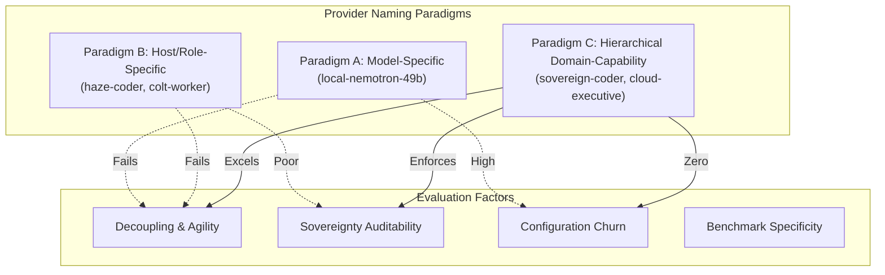

# Staff Decision Paper: Local Provider Naming Architecture & Conventions

**Document ID:** `DEC-COLT-PROVIDER-NAMING-2026-09-26`
**Tracking Bead:** `cc-0iz` (P2)
**Author:** Operations Officer (`s3-operations`), Camp Colt
**Reviewing Authority:** Chief of Staff (`colt-cos`), Camp Colt
**Approving Authority:** Commander (Nick Chalko)
**Target Configuration:** `colony/city.toml` (`[providers]`, `[[rigs.patches]]`)
**Status:** PROPOSED (Submitted for Command Decision)

---

## 1. Executive Summary & Problem Statement

In Camp Colt's municipal architecture (`city.toml`), agent roles are bound to model execution backends via **Providers** (`[providers.<name>]`). During the initial deployment and pilot phases, ad-hoc naming conventions emerged:

- `local-litellm`: Configured in `city.toml`, but pointing directly to `http://10.82.0.3:8000/v1` (bypassing the LiteLLM gateway).
- `local-nemotron`: Redundant duplicate provider pointing to the same endpoint with the same model.
- `haze-coder` / `haze-worker`: Historical conventions inherited from London Fog (`colt-haze`) coupling agent identity to specific physical hostnames.

This ad-hoc naming creates three critical operational vulnerabilities:

1. **Tight Coupling to Physical Weights:** Naming a provider after specific weights (`local-nemotron-49b`) forces every rig configuration (`city.toml`), worker formula, and bead patch to be rewritten whenever model weights are upgraded, quantized differently, or swapped (e.g., migrating to Qwen 2.5 Coder 32B or DeepSeek R1).
2. **Topological Ambiguity:** Naming a provider `local-litellm` while pointing it directly to vLLM on port 8000 creates architectural confusion between direct inference and proxy gateway routing.
3. **Sovereignty Boundary Masking:** Without an explicit domain prefix, operators cannot audit whether an agent session is guaranteed to execute on local silicon or risks cloud API draw.

This paper evaluates three naming paradigms and establishes a unified doctrinal standard.

---

## 2. Evaluation of Architectural Paradigms



### Paradigm A: Vendor / Model-Specific Naming

_Examples:_ `local-nemotron-49b`, `vllm-llama33-fp8`, `claude-37-sonnet`, `gemini-25-flash`

- **Mechanism:** Provider keys directly identify the vendor, model family, and quantization tier.
- **Advantages:**
  - Maximum transparency: The exact weights serving the request are obvious from the provider identifier.
  - Granular benchmarking: Ideal for side-by-side comparative evaluations (e.g. TC-01 benchmark runs).
- **Disadvantages:**
  - Extreme configuration churn: Swapping from `nemotron-49b` to an updated release breaks all existing rig patches across `city.toml`.
  - Violates separation of concerns: Tactical worker agents (`gc.implementation-worker`) require a _competent coding engine_, not a hardcoded weight tag.

### Paradigm B: Host / Rig / Historical Role Naming

_Examples:_ `haze-coder`, `haze-worker`, `colt-worker`, `cp01-local`

- **Mechanism:** Provider keys embed physical host enclaves or municipal roles into the name.
- **Advantages:**
  - Reflects physical homelab geography (`haze`, `misty`, `colt-gpu-01`).
- **Disadvantages:**
  - Brittle topology: If workloads migrate across hypervisor nodes or rigs, host-named providers become misnomers.
  - Conflates infrastructure placement with agent cognitive profile.

### Paradigm C: Hierarchical Domain-Capability Tiering (Recommended)

_Examples:_ `sovereign-coder`, `sovereign-general`, `sovereign-fast`, `cloud-executive`, `cloud-fallback`

- **Mechanism:** A two-axis naming taxonomy: `<domain>-<capability>`
  1. **Domain Axis:** Defines the physical and jurisdictional execution boundary:
     - `sovereign`: Exclusively on-premise bare metal (ASUS Ascent GX10 / Grace Blackwell GB10 @ `10.82.0.3` or cluster vLLM/NIM). Zero cloud fallback.
     - `cloud`: External commercial frontier APIs (Google Gemini, Anthropic Claude).
     - `bench`: Model-pinned evaluation providers for deterministic benchmarking.
  2. **Capability Axis:** Defines the cognitive and parameter profile:
     - `coder`: Low temperature ($\le 0.1$), extended output window ($16\text{k}$ tokens), strict AST tool calling for multi-turn code generation and unit testing.
     - `general`: Balanced temperature ($0.2$), medium output ($4\text{k}$ tokens) for task decomposition, requirements planning, and gap analysis.
     - `fast`: Sub-second TTFT, high TPS for routine triage, git status sweeps, and bivouac police calls.
     - `executive`: Maximum reasoning depth, large context for cross-theater planning and architectural decisions.

---

## 3. Comparison Matrix

| Evaluation Dimension                           | Paradigm A (Model-Specific)        | Paradigm B (Host/Role)        | Paradigm C (Domain-Capability Tier)          |
| :--------------------------------------------- | :--------------------------------- | :---------------------------- | :------------------------------------------- |
| **Separation of Concerns**                     | Poor (leaky weight abstraction)    | Poor (leaky host abstraction) | **Excellent (contract-driven)**              |
| **Upgrade Churn in `city.toml`**               | High (must edit all rig patches)   | Medium                        | **Zero (change single provider definition)** |
| **Sovereignty Boundary Audit**                 | Moderate (must inspect model tags) | Poor                          | **Immediate (`sovereign-*` prefix)**         |
| **Tool Parameter Clamping**                    | Manual per model                   | Ad-hoc                        | **Standardized per capability tier**         |
| **Benchmarking Isolation**                     | High                               | Low                           | **Handled cleanly via `bench-*` namespace**  |
| **Alignment with `STRAT-COLT-TIERED-ROUTING`** | Low                                | Low                           | **100% Direct Parity**                       |

---

## 4. Doctrinal Specification & Recommendations

### 4.1 Canonical Provider Schema for `city.toml`

Under this decision, `colony/city.toml` will standardize on the following canonical provider declarations:

```toml
[providers]

# --- 1. SOVEREIGN ON-PREMISE INFRASTRUCTURE (GB10 @ 10.82.0.3) ---

[providers.sovereign-coder]
base = "builtin:opencode"
ready_delay_ms = 100
[providers.sovereign-coder.env]
OPENAI_API_BASE = "http://10.82.0.3:8000/v1"
OPENAI_MODEL = "nvidia/llama-3.3-nemotron-super-49b-v1.5"
OPENAI_API_KEY = "none"

[providers.sovereign-general]
base = "builtin:opencode"
ready_delay_ms = 100
[providers.sovereign-general.env]
OPENAI_API_BASE = "http://10.82.0.3:8000/v1"
OPENAI_MODEL = "nvidia/llama-3.3-nemotron-super-49b-v1.5"
OPENAI_API_KEY = "none"

[providers.sovereign-gateway]
base = "builtin:opencode"
ready_delay_ms = 100
[providers.sovereign-gateway.env]
OPENAI_API_BASE = "http://litellm.colt.chalko.com/v1"
OPENAI_MODEL = "worker-coder"
OPENAI_API_KEY = "sk-colt-sovereign-gateway"

# --- 2. COMMAND & CLOUD CAPABILITY TIERS ---

[providers.cloud-executive]
base = "builtin:antigravity"
ready_delay_ms = 0

# --- 3. BENCHMARKING & MODEL-PINNED HARNESSES (SPECIALIZED) ---

[providers.bench-nemotron-49b-direct]
base = "builtin:opencode"
ready_delay_ms = 100
[providers.bench-nemotron-49b-direct.env]
OPENAI_API_BASE = "http://10.82.0.3:8000/v1"
OPENAI_MODEL = "nvidia/llama-3.3-nemotron-super-49b-v1.5"
OPENAI_API_KEY = "none"
```

### 4.2 Standard Rig Patch Conventions

Rig patches in `city.toml` will reference capability tiers rather than vendor strings:

```toml
# Example: System Under Test Rig (colt-utils)
[[rigs.patches]]
agent = "implementation-worker"
provider = "sovereign-coder"
session = "acp"

[[rigs.patches]]
agent = "task-decomposer"
provider = "sovereign-general"
session = "acp"
```

### 4.3 Deprecation & Backward-Compatibility Path

To ensure zero immediate disruption to active running sessions:

1. **Phase 1 (Aliasing):** Add `sovereign-coder` and `sovereign-general` to `city.toml` while retaining `local-litellm` and `local-nemotron` as compatibility aliases.
2. **Phase 2 (Rig Patch Migration):** Update `city.toml` rig patches across `go_template_rule` and `colt-utils` to target `sovereign-coder`.
3. **Phase 3 (Deprecation Cleanup):** Remove obsolete `local-litellm` and `local-nemotron` entries once all sessions have reloaded.

---

## 5. Staff Action & Approval Routing

- **Staff Recommendation:** Adopt **Paradigm C (Hierarchical Domain-Capability Tiering)** as Camp Colt municipal doctrine.
- **Next Steps upon Approval:**
  1. Author patch to `colony/city.toml` implementing canonical `sovereign-*` provider blocks.
  2. Update `docs/TIERED_PROVIDER_ROUTING_STRATEGY.md` and `docs/SOP_WATCH_POSTURE.md` to reference `sovereign-coder` / `sovereign-general`.
  3. Close bead `cc-0iz`.
