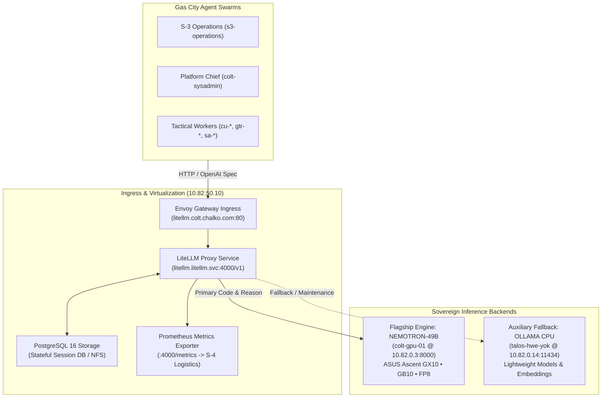

# Camp Colt LiteLLM Gateway Architecture & Local Model Proxy Specification

```
Document ID:     ARCH-COLT-LITELLM-GATEWAY
Classification:  BATTALION STAFF / S-3 OPERATIONS & S-4 LOGISTICS SPECIFICATION
Author:          S-3 Operations Officer (s3-operations), Camp Colt
Reviewing Gates: Platform Chief (colt-sysadmin), S-6 Signal & Cyber Officer (s6-signal), S-4 Logistics
Reference:       Epic cc-32m.2 / OPLAN-COLT-2026-09-01-LOCAL-MODELS
Date:            2026-09-22
```

---

## 1. Executive Summary & Problem Analysis

In sovereign multi-agent computing enclaves like Camp Colt, heterogeneous agents (running under Antigravity, OpenCode, or custom polecat harnesses) must communicate seamlessly with local neural inference backends without hardcoding engine-specific networking, authentication tokens, or inference formats.

Furthermore, S-4 Logistics requires centralized telemetry to track GPU resource draw, token expenditure, and Radix KV prefix cache hit rates, while S-6 Signal mandates header sanitization and zero plaintext secrets on disk.

The **LiteLLM Gateway** provides an OpenAI-compatible translation, routing, and observability layer that decouples Gas City agent providers from physical inference engines.



---

## 2. Ingress & Network Topology

| Component            | Network Endpoint                                           | Scope            | Protocol | Node / Host                    |
| :------------------- | :--------------------------------------------------------- | :--------------- | :------- | :----------------------------- |
| **Ingress VIP**      | `10.82.50.10:80`                                           | Appliance VIP    | HTTP/1.1 | Envoy Gateway                  |
| **Virtual FQDN**     | `http://litellm.colt.chalko.com`                           | Internal DNS     | HTTP/1.1 | Route via Ingress VIP          |
| **Cluster Ingress**  | `http://litellm.litellm.svc.cluster.local:4000/v1`         | Cluster Internal | HTTP/1.1 | `talos-hwe-yok` (`10.82.0.14`) |
| **Primary Backend**  | `http://nemotron-49b.nim-system.svc.cluster.local:8000/v1` | Cluster Internal | HTTP/1.1 | `colt-gpu-01` (`10.82.0.3`)    |
| **Fallback Backend** | `http://ollama.ollama.svc.cluster.local:11434`             | Cluster Internal | HTTP/1.1 | `talos-hwe-yok` (`10.82.0.14`) |

---

## 3. Gas City Provider Integration Specifications

### 3.1 Gas City Workspace Configuration (`city.toml`)

To route autonomous workers to the local LiteLLM proxy, `city.toml` defines the local model provider interface:

```toml
[providers.local_model]
base = "builtin:opencode"
api_base = "http://litellm.colt.chalko.com/v1"
default_model = "nemotron-super-49b-v1.5"
ready_delay_ms = 0

[providers.local_model.env]
OPENAI_API_BASE = "http://litellm.colt.chalko.com/v1"
OPENAI_MODEL_NAME = "nemotron-super-49b-v1.5"
# Token is memory-mapped via /dev/shm or local environment injection
OPENAI_API_KEY = "local-nim-key"
```

### 3.2 Site Override Configuration (`.gc/site.toml`)

Per-host and developer workstation overrides bind through `.gc/site.toml`:

```toml
[provider.overrides]
api_base = "http://10.82.50.10/v1"
headers = { "X-Camp-Colt-Origin" = "local-agent-enclave" }
```

### 3.3 Audit & Telemetry Headers

Every agent request routed through LiteLLM includes non-sensitive contextual headers for auditability:

- `X-Agent-ID`: The calling session identity (e.g. `s3-operations`, `cu-worker-01`).
- `X-Rig-Target`: Target rig repository (e.g. `colt-utils`, `go_template_rule`).
- `X-Session-ID`: Gas City session UUID.
- `X-Bead-ID`: The active task bead being processed.

---

## 4. S-4 Logistics & Observability Architecture

### 4.1 Prometheus Metrics Pipeline

LiteLLM exposes unauthenticated Prometheus metrics at `/metrics`, scraped by `kube-prometheus-stack` every 15 seconds:

- `litellm_requests_metric_total`: Total request counter categorized by model, status code, and caller.
- `litellm_deployment_latency_per_output_token`: Inter-Token Latency (ITL) tracking generation performance.
- `litellm_deployment_time_to_first_token`: Time-to-First-Token (TTFT) distribution (Target SLA: $<500\text{ ms}$).
- `litellm_tokens_consumed_total`: Cumulative token accounting (prompt, completion, and cache-hit tokens).

### 4.2 S-4 Logistics Allocation & Accounting

```
Daily GPU Compute Draw = Sum(Completion Tokens) * Hardware Efficiency Factor (W/tok)
Prefix Cache Savings   = Prompt Tokens Hit * Avoided Compute Ratio
```

With the Grace Blackwell GB10 Radix KV prefix cache hit rate empirically validated at **$91.5\%$**, shared system prompts across swarm workers yield an order-of-magnitude reduction in compute latency and power draw.

---

## 5. Resilience, Concurrency & Failover Routing

### 5.1 Concurrency & Queue Watermarks

- **Hardware Capacity:** NVIDIA Grace Blackwell GB10 running NIM 49B supports up to 64 concurrent sequences (`NIM_MAX_NUM_SEQS = 64`).
- **LiteLLM Concurrency Cap:** The router enforces a maximum concurrency ceiling of 48 active requests, holding the remaining 16 slots in reserve for interactive high-priority command sessions (`cos`, `s3-operations`).
- **Queue Timeout:** LiteLLM router times out requests queued longer than 120 seconds (`timeout: 120`).

### 5.2 Automatic Retry & Failover Strategy

- **Retry Budget:** `num_retries: 2` with exponential backoff ($500\text{ ms} \rightarrow 2000\text{ ms}$).
- **Degraded Host Failover:**
  - If `colt-gpu-01` reports HTTP 503 or becomes unreachable during hardware maintenance, non-coding metadata and summarization tasks automatically fall back to CPU Ollama on `talos-hwe-yok`.
  - Code generation tasks are queued or cleanly deferred in the beads database with label `hold:gpu-offline`.

---

## 6. Zero-Secret Credentials & Security Posture

1. **HashCorp Vault Authority:** Master proxy credentials and backend access tokens are stored in Vault (`colt-vault` @ `10.82.0.5:8200`) under path `secret/data/colt/litellm/master_key`.
2. **Kubernetes Projection:** External Secrets Operator synchronizes the credential into Kubernetes Secret `litellm-secrets`.
3. **Agent POSIX Boundary:** Agents operate under unprivileged POSIX identities with zero standing root access. Credentials are never written to disk in plain text; agents access ephemeral tokens via memory-backed `/dev/shm` mounts.
4. **Header Sanitization:** LiteLLM sanitizes all request/response headers, dropping internal cluster topology markers and stripping debug tokens (`drop_params: true`).

---

## 7. Operational Recommendations for Phase 3 Pilot

1. **Rig Binding:** In Phase 3 (`cc-32m.3`), configure the worker agent in [`rigs/colt-utils`](file:///home/camp-colt-mayor-agent/colony/rigs/colt-utils) to route through `http://litellm.colt.chalko.com/v1` targeting model `nemotron-super-49b-v1.5`.
2. **Validation:** Monitor S-4 token usage metrics in Grafana (`grafana.colt.chalko.com`) during task execution to confirm accurate telemetry collection.

---

## 8. Billet Review & Approval Block

**Authored By:**
_S-3 Operations Officer (`s3-operations`)_
Camp Colt Combat Operations Center
Date: 2026-09-22

**Platform Architecture Concurrence:**
_Platform Chief (`colt-sysadmin`)_
Disposition: CONCUR (ref `cc-wisp-dgn0`)
Date: 2026-09-22

**Quality Assurance & Signal Concurrence:**
_S-6 Signal & Cyber Officer (`s6-signal`)_
Disposition: CONCUR (Phase 2 Gate Cleared)
Date: 2026-09-22

**Operational Endorsement:**
_Chief of Staff (`cos`)_
Camp Colt Battalion Headquarters
