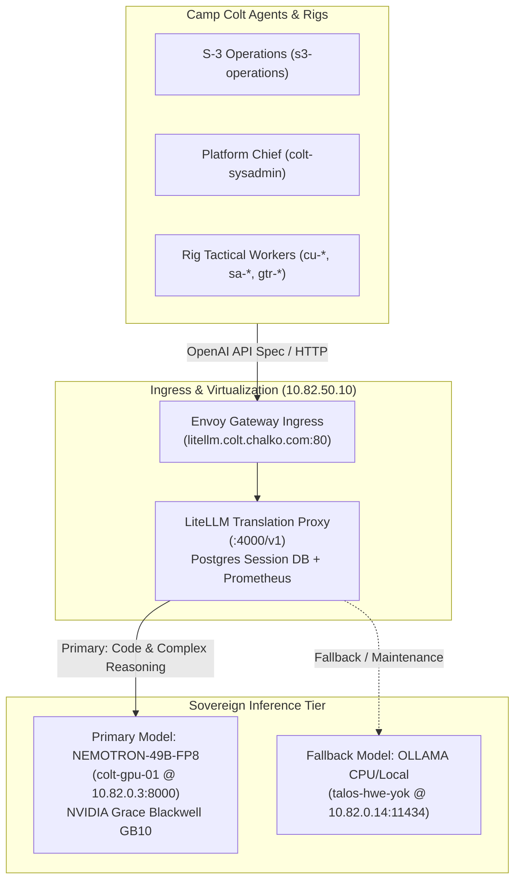

# Camp Colt Standard Operating Procedure: Per-Rig Local Models & Air-Gapped Operation

```
Document ID:     SOP-COLT-LOCAL-MODELS
Classification:  CAMP COLT SOVEREIGN APPLIANCE OPERATIONAL DOCTRINE
Author:          S-3 Operations Officer (s3-operations)
Approved by:     Chief of Staff (cos)
Coordinating:    Platform Chief (colt-sysadmin), S-6 Signal & Cyber (s6-signal), Mayor (mayor)
Tracking Bead:   cc-32m.4 (Epic cc-32m)
Date:            2026-09-24
```

---

## 1. Purpose & Scope

Camp Colt operates as the sovereign command post, AI agent factory, and offline-first computing enclave for Suitcase AI. To preserve computational sovereignty, prevent unauthorized telemetry egress, and guarantee operational continuity in air-gapped or network-partitioned states, Camp Colt maintains dedicated on-premise neural inference infrastructure.

This Standard Operating Procedure (SOP) defines:
1. Declarative configuration of local model providers in `city.toml` and per-rig manifests.
2. Named session wiring and environment variable bindings.
3. Air-gap, offline, and zero-egress validation procedures (MCO 3070.2).
4. `gc doctor` compliance and health check integration.
5. Operational triage, fallback routing, and error recovery workflows.

---

## 2. Infrastructure Architecture & Network Endpoints

Physical and virtual inference routing flows through the sovereign LiteLLM Gateway deployed within the local Kubernetes cluster (`10.82.0.0/16`):



### Sovereign Network Directory

| Service | Endpoint FQDN / VIP | Cluster Service | Protocol | Role |
| :--- | :--- | :--- | :--- | :--- |
| **Gateway VIP** | `http://10.82.50.10:80` | `envoy-gateway` | HTTP/1.1 | VIP Ingress |
| **Virtual FQDN** | `http://litellm.colt.chalko.com` | `envoy-gateway` | HTTP/1.1 | Host DNS Ingress |
| **Cluster Proxy**| `http://litellm.litellm.svc:4000/v1` | `litellm` | HTTP/1.1 | Pod-to-Pod Internal |
| **Primary Backend** | `http://10.82.0.3:8000/v1` | `nemotron-49b` | HTTP/1.1 | Flagship 49B FP8 Engine |
| **Fallback Backend**| `http://10.82.0.14:11434` | `ollama` | HTTP/1.1 | Auxiliary CPU Fallback |

---

## 3. Configuration & Wiring

### 3.1 Global `city.toml` Provider Declaration

To declare local inference providers in the municipal root configuration (`colony/city.toml`):

```toml
# city.toml

[workspace]
provider = "antigravity"

# Provider declaration for sovereign local LiteLLM proxy
[providers.local-litellm]
base = "builtin:opencode"
ready_delay_ms = 100
[providers.local-litellm.env]
OPENAI_API_BASE = "http://litellm.colt.chalko.com/v1"
OPENAI_MODEL = "nemotron-49b"
REQUESTS_CA_BUNDLE = "/etc/ssl/certs/ca-certificates.crt"

# Auxiliary local fallback provider
[providers.local-ollama]
base = "builtin:opencode"
ready_delay_ms = 100
[providers.local-ollama.env]
OPENAI_API_BASE = "http://10.82.0.14:11434/v1"
OPENAI_MODEL = "qwen2.5-coder:14b"
```

### 3.2 Named Session Binding

To bind a permanent command billet or rig session to the local provider:

```toml
[[named_session]]
name = "colt-utils-worker"
template = "colt-utils-worker"
dir = "rigs/colt-utils"
mode = "demand"
provider = "local-litellm"
```

### 3.3 Ephemeral Tactical Workers (Polecats)

When slinging task beads to ephemeral tactical workers under local models, specify the provider override on launch:

```bash
# Sling a bead to a local model worker
gc sling colt-utils-worker <bead-id> --provider local-litellm
```

---

## 4. Air-Gap & OPSEC Enforcement (MCO 3070.2)

### 4.1 Strict In-Memory Credential Policy
- **Zero Plaintext Secrets on Disk:** No API keys, tokens, or credentials may be written to `.env`, `.bashrc`, or configuration files.
- **Memory-Backed Mounts:** Dynamic tokens or session nonces must reside strictly within `/dev/shm` memory-backed mounts.
- **Local Dummy Keys:** The LiteLLM proxy accepts any sanitization token for internal routing (e.g. `sk-camp-colt-local`), avoiding reliance on external authentication services.

### 4.2 Network Egress Sanitization
1. **Firewall & Route Tables:** Sovereign nodes (`colt-hq`, `colt-gpu-01`) drop all egress to public ranges (`0.0.0.0/0`) except for authorized mirrored registries.
2. **DNS Leak Prevention:** Agents must not execute lookups against public resolvers (`8.8.8.8`, `1.1.1.1`). All name resolution is confined to `10.82.0.10` / internal cluster CoreDNS.
3. **Verification Command:**
   ```bash
   # Empirical air-gap audit command
   curl -I --connect-timeout 2 https://api.openai.com 2>&1 | grep -q "Connection timed out\|Network is unreachable" \
     && echo "AIR-GAP VERIFIED: Outbound egress blocked" \
     || echo "SECURITY ALERT: Uncontrolled egress detected"
   ```

---

## 5. Verification & Health Monitoring

### 5.1 Pre-Flight Health Checks

Before dispatching tactical workers to local models, verify service endpoints:

```bash
# 1. Verify LiteLLM Gateway health
curl -s -f http://litellm.colt.chalko.com/health | jq .

# 2. Query model inventory
curl -s http://litellm.colt.chalko.com/v1/models | jq '.data[].id'

# 3. Test minimal completion
curl -s -X POST http://litellm.colt.chalko.com/v1/chat/completions \
  -H "Content-Type: application/json" \
  -H "Authorization: Bearer sk-colt-local" \
  -d '{
    "model": "nemotron-49b",
    "messages": [{"role": "user", "content": "ping"}],
    "max_tokens": 10
  }' | jq '.choices[0].message.content'
```

### 5.2 Gas City Doctor Compliance

Run the municipal diagnostic suite to ensure store, runtime, and configuration integrity:

```bash
gc doctor
```

Compliance Gates:
- Provider definitions in `city.toml` must pass syntax validation.
- Working tree clean across all mounted rigs.
- No dangling session lockfiles.

---

## 6. Troubleshooting & Contingency Triage

| Symptom | Root Cause | Triage & Remedy |
| :--- | :--- | :--- |
| **HTTP 502 / 504 Gateway Timeout** | Primary backend (`colt-gpu-01`) is hydrating weights or experiencing CUDA stall. | 1. Check GPU memory via sysadmin: `ssh colt-gpu-01 nvidia-smi`.<br/>2. If GPU crashed, failover session provider in `city.toml` to `local-ollama`. |
| **SIGILL / Core Dump in Agent Runtime** | CPU instruction set missing required host features (`pclmulqdq`, `avx512`). | Verify hypervisor VM CPU type is pinned to `host` (`qm config <vmid> \| grep cpu: host`). Soft reboots do not reconfigure virtual CPU; execute full `qm stop && qm start`. |
| **High Prompt TTFT (>2000ms)** | Prefix cache miss or KV cache eviction under high concurrency. | Check Radix KV hit rate on LiteLLM metrics endpoint (`http://10.82.50.10:4000/metrics`). Coordinate with S-4 to throttle concurrent polecats. |
| **Tool Calling Malformed JSON** | Small model context overflow or syntax hallucination. | Ensure model prompt template enforces strict JSON delimiters and provides explicit field metadata in schemas. |

---

## 7. Operational Roles & Responsibilities

- **Chief of Staff (`cos`):** Authorizes failover between primary and auxiliary inference tiers.
- **S-3 Operations (`s3-operations`):** Authors FRAGOs, manages tactical worker concurrency, and monitors bead progression in the Combat Operations Center.
- **Platform Chief (`colt-sysadmin`):** Maintains physical GPU nodes, container runtimes, and hypervisor CPU/memory pinning.
- **S-6 Signal (`s6-signal`):** Validates network sanitization, ensures zero secret leakage, and executes test harness verification.
- **Mayor (`mayor`):** Enforces workspace plumbing, repository mounts, and clean git states.
