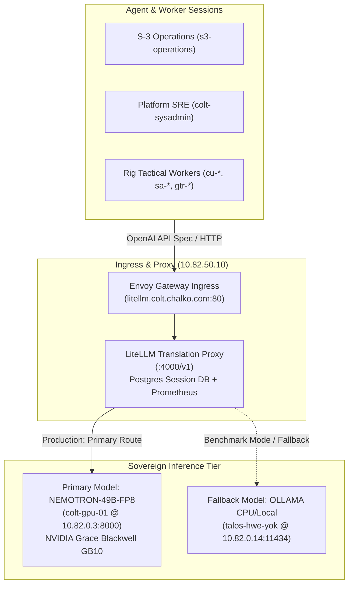

# Local Models & Inference Gateway Reference

- **Target Architecture**: Sovereign on-premise neural inference tier & LiteLLM Gateway
- **Primary Appliance**: ASUS Ascent GX10 (NVIDIA Grace Blackwell GB10 @ `10.82.0.3:8000`)
- **Fallback Backend**: Local CPU Ollama (`10.82.0.14:11434`)
- **Maintained By**: S-3 Operations

---

## 1. Purpose & Scope

Camp Colt maintains dedicated on-premise neural inference infrastructure to preserve computational sovereignty, prevent unauthorized telemetry egress, and guarantee operational continuity in air-gapped or network-partitioned states.

This document defines:

1. Operational States: Production Mode vs. Benchmark Mode.
2. Traffic drain, zero-interference verification, and fallback rerouting procedures.
3. Declarative configuration of local model providers in `city.toml` and per-rig manifests.
4. Named session wiring and environment variable bindings.
5. Air-gap, offline, and zero-egress validation procedures.
6. Health monitoring, diagnostic verification, and contingency triage.

---

## 2. Infrastructure Architecture & Network Endpoints

Inference routing flows through the sovereign LiteLLM Gateway deployed within the local Kubernetes cluster (`10.82.0.0/16`):



### Network Directory

| Service              | Endpoint FQDN / VIP                  | Cluster Service | Protocol | Role                    |
| :------------------- | :----------------------------------- | :-------------- | :------- | :---------------------- |
| **Gateway VIP**      | `http://10.82.50.10:80`              | `envoy-gateway` | HTTP/1.1 | VIP Ingress             |
| **Virtual FQDN**     | `http://litellm.colt.chalko.com`     | `envoy-gateway` | HTTP/1.1 | Host DNS Ingress        |
| **Cluster Proxy**    | `http://litellm.litellm.svc:4000/v1` | `litellm`       | HTTP/1.1 | Pod-to-Pod Internal     |
| **Primary Backend**  | `http://10.82.0.3:8000/v1`           | `nemotron-49b`  | HTTP/1.1 | Flagship 49B FP8 Engine |
| **Fallback Backend** | `http://10.82.0.14:11434`            | `ollama`        | HTTP/1.1 | Auxiliary CPU Fallback  |

---

## 3. Operational States: Production Mode vs. Benchmark Mode

S-3 Operations continuously manages whether the local inference appliance is operating in **Production Mode** or **Benchmark Mode**.

### 3.1 Mode Definitions

- **Production Mode**:
  - The local LLM actively serves inference workloads for eligible tactical workers (`cu-*`, `sa-*`, `gtr-*`) and agent sessions.
  - LiteLLM directs primary model requests to the flagship GB10 appliance (`10.82.0.3:8000`), with failover to local CPU Ollama (`10.82.0.14:11434`) if the primary backend is temporarily unreachable.
- **Benchmark Mode**:
  - The physical GPU appliance (`colt-gpu-01` / `colt-sparkrun`) is quarantined exclusively for official benchmark execution (`sparkrun`).
  - All non-benchmark worker inference traffic is drained and redirected to fallback, ensuring zero worker queries touch the appliance during test execution.

### 3.2 The Zero-Interference Invariant

During benchmark execution, **strictly zero worker queries may hit the GPU backend**.

Background query interference causes severe measurement distortion:

1. **KV-Cache Fragmentation**: Inbound worker requests evict prefilled prompt blocks, corrupting prefix-caching benchmarks (`--enable-prefix-caching`).
2. **TTFT & Latency Spikes**: Concurrent query processing causes time-to-first-token jitter that invalidates standard deviations in leaderboard submissions.
3. **Thermal & Power Fluctuations**: Inconsistent compute bursts disrupt steady-state thermal and wattage baselines.

Any benchmark executed while worker traffic is touching port `8000` is invalid and must be aborted.

### 3.3 Benchmark Mode Enactment & Traffic Drain Procedure

Before initiating any benchmark battery:

1. **Trigger Mode Change**: Run the operational state tool:

   ```bash
   ./scripts/manage_llm_mode.sh benchmark
   ```

2. **Traffic Drain & Quarantine**:
   - The script sets the state marker to `benchmark` in `/dev/shm/camp-colt/llm_mode`.
   - The script actively polls network connections on port `8000` via SSH (`ss -tn sport = :8000`), waiting for active in-flight requests to complete (drain timeout: 30s).
   - Inbound worker traffic via LiteLLM is redirected to the fallback provider (`local-ollama`) or queued.
3. **Audit Zero-Interference**:

   ```bash
   ./scripts/manage_llm_mode.sh verify
   ```

   _Acceptance Criteria_: Must output `PASS: Zero-interference verified (0 connections on port 8000)`.

### 3.4 Production Mode Exit & Traffic Restoration

Immediately upon benchmark completion and artifact verification:

1. **Restore Production State**:

   ```bash
   ./scripts/manage_llm_mode.sh production
   ```

2. **Backend Health Check**:
   - The script sets the state marker to `production`.
   - Verifies responsiveness of the primary backend (`http://10.82.0.3:8000/v1/models`).
   - Confirms LiteLLM readiness endpoint (`http://10.82.50.10/health/readiness`).
3. **Resume Routing**: Eligible workers and agent sessions resume dispatching code generation and reasoning tasks to the flagship model.

---

## 4. Configuration & Wiring

### 4.1 Global `city.toml` Provider Declaration

Local inference providers declared in municipal root configuration (`colony/city.toml`):

```toml
[workspace]
provider = "antigravity"

# Provider declaration for sovereign local LiteLLM proxy
[providers.local-litellm]
base = "builtin:opencode"
ready_delay_ms = 100
[providers.local-litellm.env]
OPENAI_API_BASE = "http://litellm.colt.chalko.com/v1"
OPENAI_MODEL = "nemotron-49b"
REQUESTS_CA_BUNDLE = "/etc/ssl/certs/ca-certificates.crt"

# Auxiliary local fallback provider
[providers.local-ollama]
base = "builtin:opencode"
ready_delay_ms = 100
[providers.local-ollama.env]
OPENAI_API_BASE = "http://10.82.0.14:11434/v1"
OPENAI_MODEL = "qwen2.5-coder:14b"
```

### 4.2 Named Session Binding

To bind a named session or rig to the local provider:

```toml
[[named_session]]
name = "colt-utils-worker"
template = "colt-utils-worker"
dir = "rigs/colt-utils"
mode = "demand"
provider = "local-litellm"
```

### 4.3 Tactical Workers (Polecats)

When dispatching tactical workers to local models:

```bash
gc sling colt-utils-worker <bead-id> --provider local-litellm
```

---

## 5. Security & Air-Gap Enforcement

### 5.1 Strict In-Memory Credential Policy

- **Zero Plaintext Secrets on Disk:** No API keys, tokens, or credentials may be written to `.env`, `.bashrc`, or configuration files.
- **Memory-Backed Mounts:** Dynamic tokens or session nonces must reside strictly within `/dev/shm` memory-backed mounts.
- **Local Dummy Keys:** The LiteLLM proxy accepts any sanitization token for internal routing (e.g. `sk-camp-colt-local`).

### 5.2 Network Egress Sanitization

1. **Firewall & Route Tables:** Sovereign nodes (`colt-hq`, `colt-gpu-01`) drop all egress to public ranges (`0.0.0.0/0`) except for authorized mirrored registries.
2. **DNS Leak Prevention:** Agents must not execute lookups against public resolvers (`8.8.8.8`, `1.1.1.1`). All name resolution is confined to `10.82.0.10` / internal cluster CoreDNS.
3. **Verification Command:**

   ```bash
   curl -I --connect-timeout 2 https://api.openai.com 2>&1 | grep -q "Connection timed out\|Network is unreachable" \
     && echo "AIR-GAP VERIFIED: Outbound egress blocked" \
     || echo "SECURITY ALERT: Uncontrolled egress detected"
   ```

---

## 6. Verification & Health Monitoring

### 6.1 Pre-Flight Health Checks

Verify service endpoints:

```bash
# 1. Verify LiteLLM Gateway health
curl -s -H "Host: litellm.colt.chalko.com" http://10.82.50.10/health/readiness | jq .

# 2. Query model inventory on primary GPU backend
curl -s http://10.82.0.3:8000/v1/models | jq '.data[].id'

# 3. Check operational mode
./scripts/manage_llm_mode.sh status
```

### 6.2 Diagnostic Compliance

Run the municipal diagnostic suite:

```bash
gc doctor
```

---

## 7. Troubleshooting & Contingency Triage

| Symptom                                 | Root Cause                                                                       | Triage & Remedy                                                                                                                             |
| :-------------------------------------- | :------------------------------------------------------------------------------- | :------------------------------------------------------------------------------------------------------------------------------------------ |
| **HTTP 502 / 504 Gateway Timeout**      | Primary backend (`colt-gpu-01`) is hydrating weights or experiencing CUDA stall. | 1. Check GPU memory: `ssh colt-sparkrun nvidia-smi`.<br/>2. If GPU crashed, failover session provider in `city.toml` to `local-ollama`.     |
| **SIGILL / Core Dump in Agent Runtime** | CPU instruction set missing required host features (`pclmulqdq`, `avx512`).      | Verify hypervisor VM CPU type is pinned to `host` (`qm config <vmid> \| grep cpu: host`).                                                   |
| **High Prompt TTFT (>2000ms)**          | Concurrent queries or KV cache eviction.                                         | Check operational mode (`./scripts/manage_llm_mode.sh status`). Ensure benchmark mode was not running concurrently with production queries. |
| **Tool Calling Malformed JSON**         | Small model context overflow or syntax hallucination.                            | Ensure model prompt template enforces strict JSON delimiters and provides explicit field metadata in schemas.                               |

---

## 8. Operational Responsibilities

- **S-3 Operations (`s3-operations`):** Manages operational modes (Production vs Benchmark), executes traffic drain, verifies zero-interference, and dispatches benchmarks.
- **Chief of Staff (`cos`):** Authorizes benchmark windows and failover between primary and auxiliary inference tiers.
- **Platform SRE (`colt-sysadmin`):** Maintains physical GPU nodes, Kubernetes deployments, and container runtimes.
- **S-6 Signal (`s6-signal`):** Validates network sanitization, proxy routing, and gateway health.
