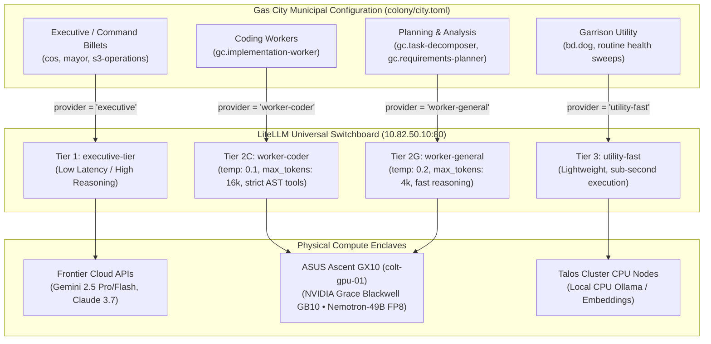

# Camp Colt Tiered Provider Routing Strategy & Operational Posture

```text
Document ID:     STRAT-COLT-TIERED-ROUTING
Document Type:   Municipal Infrastructure Strategy
Author:          Chief of Staff (colt-cos), Camp Colt
Approved by:     Commander (Nick Chalko)
Strategic Ref:   Commander's Planning Guidance (CPG) & Strategic Plans Tiered LiteLLM Plan
Target File:     colony/city.toml
Date:            2026-09-24
```

---

## 1. Architectural Philosophy: Capability Tiers vs. Physical Models

In a sovereign multi-agent compute cluster like Camp Colt, tactical worker agents and command billets must not be tightly coupled to specific neural model weights, container tags, or physical host ports.

Instead, Camp Colt implements a **Tiered Capability Switchboard Architecture** using the local **LiteLLM Gateway** (`http://litellm.colt.chalko.com/v1`):



### Core Benefits

1. **Model Independence**: Swapping local weights (e.g. from `nemotron-49b` to `qwen2.5-coder-32b` or `deepseek-r1`) requires changing a single entry in LiteLLM's `model_list`. Zero agent configs, rig bindings, or worker prompt templates break.
2. **Dynamic Parameter Clamping**: LiteLLM modulates parameters per tier (e.g. strict low temperature and extended token limits for coding; higher temperature and fast token ceilings for planning).
3. **Operational Sovereignty & Cost Guardrails**: Expensive commercial APIs are restricted to executive command billets, while parallel worker swarms execute at zero marginal token cost on on-premise silicon.

---

## 2. Standardized Capability Tiers

| Capability Tier                | Logical Model Name | Primary Backend                                    | Parameters & Tuning                                    | Operational Role & Billet Fit                                                                                                                                               |
| :----------------------------- | :----------------- | :------------------------------------------------- | :----------------------------------------------------- | :-------------------------------------------------------------------------------------------------------------------------------------------------------------------------- |
| **Tier 1 (Executive)**         | `executive-tier`   | Frontier Cloud (Gemini / Claude) or Local 70B      | `effort: medium/high`<br>`temp: 0.2`                   | **High IQ + Low Latency**: Command Staff (`cos`, `mayor`, `s3-operations`, lead planners) for cross-rig coordination, architecture reviews, and high-level decision-making. |
| **Tier 2C (Worker - Coder)**   | `worker-coder`     | ASUS Ascent GX10 (`colt-gpu-01`, Nemotron-49B FP8) | `temp: 0.1`<br>`max_tokens: 16384`<br>AST Tool Calling | **Smart + High Throughput Code Specialist**: Tactical workers (`gc.implementation-worker`) executing multi-turn file edits, unit test repairs, and refactors.               |
| **Tier 2G (Worker - General)** | `worker-general`   | ASUS Ascent GX10 (`colt-gpu-01`, Nemotron-49B FP8) | `temp: 0.2`<br>`max_tokens: 4096`<br>Fast TTFT         | **Smart + High Throughput General Purpose**: Planners, gap analysts, and decomposers (`gc.task-decomposer`, `gc.requirements-planner`) generating structured task beads.    |
| **Tier 3 (Utility - Fast)**    | `utility-fast`     | Local CPU Ollama (or low-cost cloud flash-lite)    | `temp: 0.0`<br>`max_tokens: 1024`                      | **Lightweight Utility**: Garrison dog (`bd.dog`), automated health/git sweeps, simple classification, and exit-code reporting.                                              |

---

## 3. Gas City Worker Cognitive Matrix

The standard roles imported across rigs from `gascity/roles` map to capability tiers as follows:

| Gas City Agent Role                 | Cognitive Demands                                      | Target Provider Tier              | Session Engine   |
| :---------------------------------- | :----------------------------------------------------- | :-------------------------------- | :--------------- |
| **`gc.implementation-worker`**      | File system AST edits, code generation, test debugging | `worker-coder`                    | OpenCode (`acp`) |
| **`gc.implementation-reviewer`**    | Security audit, diff analysis, edge-case detection     | `worker-coder` (or `cloud-heavy`) | OpenCode (`acp`) |
| **`gc.review-synthesizer`**         | Merging review comments into coherent guidance         | `worker-general`                  | OpenCode (`acp`) |
| **`gc.task-decomposer`**            | Deterministic JSON/YAML task bead creation             | `worker-general`                  | OpenCode (`acp`) |
| **`gc.requirements-planner`**       | Scope definition, acceptance criteria drafting         | `worker-general`                  | OpenCode (`acp`) |
| **`gc.design-author`**              | Architecture design, mermaid diagrams, specifications  | `worker-general` (or `executive`) | OpenCode (`acp`) |
| **`gc.gap-analyst`**                | State vs. requirement discrepancy analysis             | `worker-general`                  | OpenCode (`acp`) |
| **`gc.issue-triager`**              | Inbound bead routing, label assignment                 | `utility-fast`                    | OpenCode (`acp`) |
| **`gc.run-operator` / `publisher`** | Git branch pushes, PR creation, run logging            | `utility-fast`                    | OpenCode (`acp`) |
| **`bd.dog`**                        | Bivouac police calls, test suite execution             | `utility-fast`                    | Builtin Harness  |

---

## 4. The 3 Operational States

Camp Colt operates across three distinct operational postures depending on hardware availability, campaign milestones, and cost constraints:

### State 1: All Cloud (Maintenance / Heavy Cloud Mode)

- **Operational Purpose**: Used when the ASUS Ascent GX10 is offline, undergoing maintenance, or running isolated physical training/tuning workloads.
- **Posture**: All workers across all rigs execute via cloud models.
- **Configuration**:

  ```toml
  # city.toml (State 1)
  [workspace]
  provider = "cloud-fast"

  [defaults.agent]
  provider = "cloud-fast"
  # Zero local [[patches.agent]] blocks active
  ```

### State 2: Full Sovereign (Primary Operational Posture)

- **Operational Purpose**: Maximum computational sovereignty, zero cloud token expenditure, and complete offline resilience per CPG Invariant #2 and #4.
- **Posture**: All tactical workers across all rigs default to the on-premise Grace Blackwell GB10 via LiteLLM.
- **Configuration**:

  ```toml
  # city.toml (State 2)
  [defaults.agent]
  provider = "worker-coder"

  # Optional cloud escalation for high-level synthesis:
  [[patches.agent]]
  name = "*/gc.review-synthesizer"
  provider = "executive"
  ```

### State 3: SUT Sandbox (System Under Test — Current Pilot Mode)

- **Operational Purpose**: Controlled experimental pilot where only the designated System Under Test rig (`colt-utils`) runs on the local sovereign engine, while the rest of the colony (`suitcase-ai`, `go_template_rule`, `colt-results`, `a-staff`) remains on proven cloud providers.
- **Posture**: Colony defaults stay cloud-backed; only `colt-utils` workers are patched to local providers.
- **Configuration**:

  ```toml
  # city.toml (State 3: SUT Pilot)
  [workspace]
  provider = "antigravity"

  [defaults.agent]
  provider = "cloud-fast"

  # SUT Sandbox Patches (colt-utils only):
  [[patches.agent]]
  name = "colt-utils/gc.implementation-worker"
  provider = "worker-coder"
  session = "acp"

  [[patches.agent]]
  name = "colt-utils/gc.task-decomposer"
  provider = "worker-general"
  session = "acp"

  [[patches.agent]]
  name = "colt-utils/gc.requirements-planner"
  provider = "worker-general"
  session = "acp"
  ```

---

## 5. Standardized `city.toml` Provider Block

To implement this strategy, `colony/city.toml` maintains the following canonical `[providers]` declaration:

```toml
[providers]

# --- Sovereign Local Tiers (colt-hq -> LiteLLM -> Grace Blackwell GB10) ---
[providers.worker-coder]
acp_command = "/home/linuxbrew/.linuxbrew/bin/opencode"
acp_args = ["acp", "--log-level", "INFO"]
supports_acp = true
ready_delay_ms = 0
env = { OPENAI_API_BASE = "http://litellm.colt.chalko.com/v1", OPENAI_MODEL = "worker-coder" }

[providers.worker-general]
acp_command = "/home/linuxbrew/.linuxbrew/bin/opencode"
acp_args = ["acp", "--log-level", "INFO"]
supports_acp = true
ready_delay_ms = 0
env = { OPENAI_API_BASE = "http://litellm.colt.chalko.com/v1", OPENAI_MODEL = "worker-general" }

[providers.utility-fast]
acp_command = "/home/linuxbrew/.linuxbrew/bin/opencode"
acp_args = ["acp", "--log-level", "INFO"]
supports_acp = true
ready_delay_ms = 0
env = { OPENAI_API_BASE = "http://litellm.colt.chalko.com/v1", OPENAI_MODEL = "utility-fast" }

# --- Cloud Tiers ---
[providers.executive]
base = "builtin:antigravity"
args = ["--effort", "medium"]

[providers.cloud-fast]
base = "builtin:antigravity"
args = ["--effort", "low"]

[providers.cloud-claude]
base = "builtin:claude"
```

---

## 6. Verification & State Transition Protocol

When transitioning the colony between operational states:

1. **Config Validation**: Execute `gc config show` to confirm provider resolution and verify that no orphaned or unresolvable provider references exist.
2. **Diagnostic Bill of Health**: Execute `gc doctor` to verify that workspace hygiene, named sessions, and session reconcilers pass 100% cleanly.
3. **Smoke Probe**: Dispatch a single test bead to the affected rig's worker to confirm end-to-end token generation and tool calling before opening the rig for production workloads.
