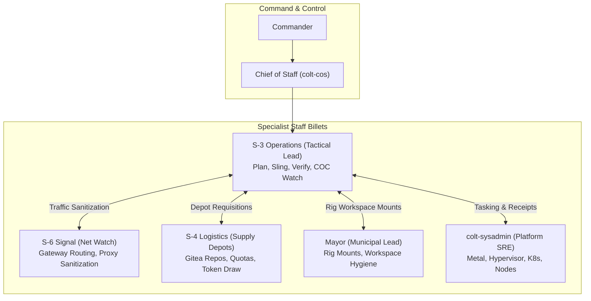

# Staff After Action Review (AAR): S-Staff Coordination, Planning Workflows & Completed Staff Work Standards

```text
Document ID:     AAR-ASTAFF-CC32M-001
Tracking Bead:   cc-3eq (P2)
Campaign Ref:    cc-32m (Operation Sovereign Inference Engine)
Lead Proponent:  S-3 Operations Officer (s3-operations), Camp Colt
Reviewing Auth:  Chief of Staff (colt-cos), Camp Colt
Approving Auth:  Commander (Nick Chalko)
Date:            2026-09-26
Status:          COMPLETED STAFF WORK
```

---

## 1. Executive Summary & Operational Scope

This After Action Review (AAR) evaluates the operational execution, cross-staff coordination, tactical planning workflows, and Completed Staff Work standards (MCTP 3-30A) demonstrated across the initial deployment and sovereign pilot of Operation `cc-32m` (Llama-3.3-Nemotron-Super-49B on the ASUS Ascent GX10 NVIDIA Grace Blackwell GB10 @ `10.82.0.3`) and the migration of `spark-to-k8s` to `colt-utils`.

The first iteration of `cc-32m` decisively proved that complex multi-turn agentic software development can be served entirely on local sovereign silicon with **0.00% cloud fallback** and **0.00% CPU offload**, generating over 1,060,000 tokens during the active pilot. However, the operation surfaced critical coordination friction, architectural boundaries, and report standardization lessons that are formally codified in this review.

---

## 2. Pillar 1: S-Staff Coordination & Billet Boundary Discipline



### 2.1 The "Zero `kubectl`" Staff Invariant

- **The Friction:** Early in the campaign, operational staff officers (`s3-operations`) occasionally attempted to invoke `kubectl` or direct cluster admin commands to query pods, ingress routes, or daemon logs.
- **The Finding:** Cluster administration, Kubernetes manifests, and bare-metal hypervisor state belong strictly to the **Platform Chief (`colt-sysadmin`)**. When multiple staff officers execute cluster mutations or ad-hoc diagnostic commands, RBAC security is compromised, and cluster state drifts from GitOps declarations.
- **The Doctrinal Standard:**
  1. Staff officers and tactical workers must **NEVER execute `kubectl`**.
  2. Telemetry and metric inspection must route strictly over HTTP via the Grafana datasource proxy (`http://grafana.colt.chalko.com/api/datasources/proxy/1/api/v1/`).
  3. Visual telemetry must be rendered via Grafana's HTTP render service (`http://grafana.colt.chalko.com/render/d-solo/...`).
  4. Any required cluster changes (e.g. timeout increases, ingress routing, secret updates) must be formally tasked to `colt-sysadmin` via `gc mail` and bead assignment.

### 2.2 S-4 Logistics vs. Platform SRE Depot Ownership

- **The Friction:** During repo creation for `colt/a-staff` and `colt/colt-utils`, tasks bounced between the Mayor, S-3, and Platform SRE due to ambiguous administrative credentials.
- **The Doctrinal Standard:** Codified in `SOP-4.1-REPO-PROVISION` and `AGENTS.md`:
  - **Git Repositories are Digital Supply Depots (Class IX/VII):** S-4 Logistics holds sole administrative authority over Gitea repo creation, team permissions, and storage quotas.
  - **Platform SRE (`colt-sysadmin`)** maintains the underlying Gitea K8s container, persistent volumes, and PostgreSQL database only.
  - **Mayor (`mayor`)** clones issued depots into town workspaces and mounts them in `city.toml`.

---

## 3. Pillar 2: S-3 Planning Workflows & Tactical Execution

### 3.1 Phased Campaign Decomposition & FRAGO Cadence

- **What Worked:** Structuring `cc-32m` into discrete, sequential phases (`cc-32m.1` through `cc-32m.4`) backed by authoritative Fragmentary Orders (`FRAGO_01` and `FRAGO_02`) prevented tactical sprawl. Each worker executed against an explicit acceptance test suite.
- **Critical Discovery: Cardinal Rule of Evaluation:**
  - _Never Conflate Serving Benchmarks with Agentic Evaluations._
  - Serving baseline benchmarks (Tier 1: TTFT, ITL, KV cache memory bounds on GB10) must always precede autonomous agentic qualification (Tier 2: multi-turn AST tool calling, file mutation, and test verification). Testing agentic reasoning against unstable or unverified inference infrastructure wastes time diagnosing false model failures.

### 3.2 Gateway Caching Bias & Multi-Sample Benchmarking Fairness

- **The Friction:** In initial side-by-side comparative benchmarking between direct vLLM and the LiteLLM proxy, sequential runs with static prompts showed LiteLLM outperforming direct inference by $-184\text{ ms}$ TTFT.
- **The Finding:** vLLM's Radix prefix caching recognized the identical prompt prefix from the first run, granting the secondary run an artificial zero-prefill cache hit.
- **The Doctrinal Standard:**
  1. All comparative latency benchmarks must inject cold-cache randomized UUID probe nonces into prompt prefixes.
  2. Comparative testing must alternate execution order (Direct $\rightarrow$ Proxy, Proxy $\rightarrow$ Direct).
  3. Multi-sample trimmed mean sampling (dropping minimum and maximum outliers across $\ge 5$ runs) is mandatory. True proxy overhead was verified at $+9.5\text{ ms}$.

---

## 4. Pillar 3: Completed Staff Work Standards (MCTP 3-30A)

### 4.1 Empirical Receipts Over Assertions

- **The Standard:** Under MCTP 3-30A and CPG Invariant #1, staff submissions cannot rely on qualitative claims (e.g. "runs fast", "performed well", "completed successfully"). Every claim must be substantiated by empirical data:
  - Raw timeseries datasets committed as verifiable JSON artifacts (`spark_to_k8s_telemetry_raw.json`).
  - Exact PromQL queries and time bounds documented for independent verification.
  - Concrete commit hashes (`ff6a0b1`, `9bee4a3`, `c2fa37d`) and test outputs (`11/11 PASS`).
  - Turnkey inspection commands (e.g. direct Grafana dashboard URLs, curl commands).

### 4.2 Tone Hygiene: Elimination of Boilerplate and Self-Praise

- **The Lesson (cc-545g):** Early drafts of technical reports contained pseudo-military boilerplate, flowery adjectives, and self-congratulatory claims about "Completed Staff Work".
- **The Remediation:** Command explicitly intervened to enforce an objective, humble, and strictly factual engineering tone. Technical reports must plainly describe what was built, what broke, how it was fixed, and what the hardware telemetry measured—letting empirical records speak for themselves.

### 4.3 Visual Report Standardization & Timezone Discipline

- **The Lesson (cc-rgig & cc-78km):** Initial visual telemetry was inserted as a disconnected block of half-width charts rendered with UTC timestamps, creating confusion when correlating against local Pacific Time event logs.
- **The Remediation:**
  1. **Timezone Standardization:** All visual charts and Grafana reports must explicitly pass `&tz=America%2FLos_Angeles` so X-axis time series render in local Pacific Time (`PDT`/`PST`).
  2. **Full-Width Embedded Layout:** Visual charts must be rendered full-width (24-column grid, $1200\times 500\text{ px}$) and embedded directly alongside the corresponding metric tables rather than dumped into a separate appendix.
  3. **Direct Dashboard Links:** Every telemetry report must include a direct, clickable URL to the live Grafana dashboard pre-configured with the exact time window.

---

## 5. Pillar 4: Garrison Hygiene & Governance Rules Codified

1. **The Rule of Three Gate for SOPs (CPG Invariant #3):** Staff officers must not draft formal, binding Standard Operating Procedures after a single occurrence. Workflows must be tested and iterated via lightweight FRAGOs and logged in the AAR Log until proven consistent across at least **three successful executions**.
2. **Communications Hygiene:**
   - Use `gc mail ... --notify` strictly for active operational taskers, directives, and blocker escalations to wake the recipient immediately.
   - Omit `--notify` for informational, future-planning, or retrospective traffic (e.g. `AAR item: ...`).
   - Zero intermediate acknowledgment ("ACK") mails; staff officers report back upon task completion with full receipts.
3. **Zero-Dirty-Git Exit Gate & Worktree Cleanliness (SOP-0.3-WORKTREE-CLEANLINESS):**
   - Under `cc-kw0` and `cc-nqpv`, all active repositories (`camp-colt`, `a-staff`, `colt-results`, `colt-utils`, `go_template_rule`, `suitcase-ai`) were codified into a **Four-Tier Worktree & Working Tree Cleanliness Defense Architecture** ([`battlebook/SOP_GIT_WORKTREE_CLEANLINESS.md`](file:///home/camp-colt-mayor-agent/colony/rigs/a-staff/battlebook/SOP_GIT_WORKTREE_CLEANLINESS.md)):
     - **Tier 1 (Tactical Worker Clean-Exit Gate):** Tactical workers and polecats must enforce `git status --porcelain == 0` and prune any secondary worktrees before closing any task bead. Stale runtime scratch is removed or added to `.gitignore`.
     - **Tier 2 (Scripted Worktree Lifecycle & Trap Discipline):** Automation scripts dynamically creating git worktrees must register POSIX EXIT/INT/TERM traps to deterministically remove worktree directories, prune worktree references, and delete temporary branches.
     - **Tier 3 (Turnkey Municipal Audit Tooling):** The Mayor and watch officers run [`scripts/audit_git_cleanliness.sh`](file:///home/camp-colt-mayor-agent/colony/scripts/audit_git_cleanliness.sh) across colony root and all mounted rigs, verifying 0 dirty files and 0 extra worktrees.
     - **Tier 4 (Watch Cadence & Shift Handoff Discipline):** Git cleanliness is certified in every shift handoff dispatch (`gc mail`), confirmed in daily 06:00 CUB documents, and audited during Friday retrospectives.

---

## 6. Action Items & Institutional Rollup

|    Item    | Action Required                                                                                   | Responsible Billet  | Target Milestone |  Status   |
| :--------: | :------------------------------------------------------------------------------------------------ | :-----------------: | :--------------: | :-------: |
| **ACT-01** | Standardize `city.toml` local provider names on `sovereign-*` / `cloud-*` domain-capability tiers |     S-3 / Mayor     |     `cc-0iz`     | COMPLETED |
| **ACT-02** | Enforce zero `kubectl` invariant in all staff prompt templates and guidelines                     |      CoS / S-3      |   `AGENTS.md`    | CODIFIED  |
| **ACT-03** | Maintain Grafana render timeout configurations ($\ge 60\text{s}$) on Envoy route                  |    Platform SRE     |    `cc-123q`     | COMPLETED |
| **ACT-04** | Track 90-day GitHub PAT mirror expiration schedule and notify Command at $+75\text{d}$            |    S-1 Personnel    |     `cc-agw`     |  ACTIVE   |
| **ACT-05** | Enforce pre-commit passing cleanly across all rigs on every PR                                    | All Staff / Workers |     `cc-kw0`     | ENFORCED  |
| **ACT-06** | Formalize Git Worktree & Working Tree Cleanliness SOP and deploy municipal audit script           |     Mayor / S-3     |    `cc-nqpv`     | CODIFIED  |
