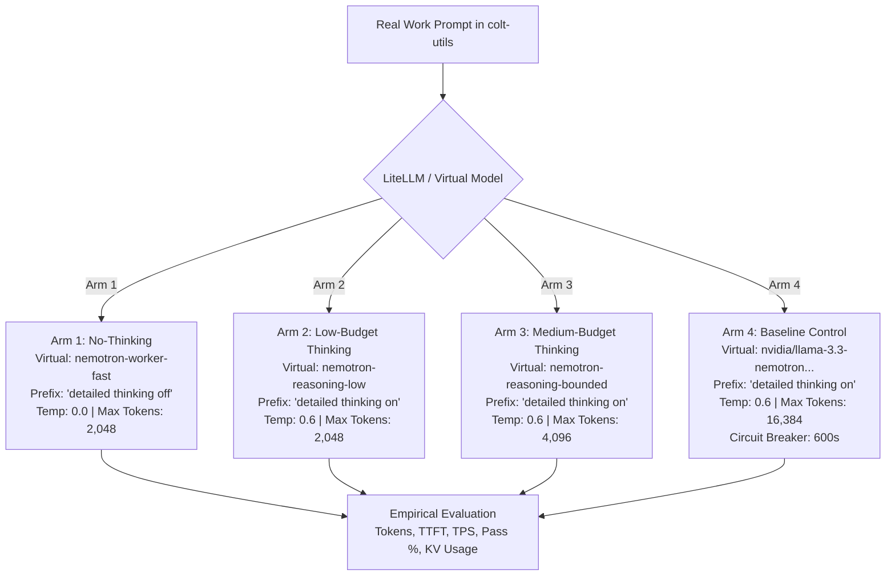

# Operational Plan: Benchmark "No Thinking" and Reasoning Effort Levers on Nemotron-49B (`cc-4466`)

**Status:** Completed (Verified: 2026-09-27)
**Date:** 2026-09-27

---

## 1. Executive Summary & Commander's Intent

### 1.1 Strategic Objective

Decisively determine which inference settings and reasoning levers produce valid, reliable code on **real workloads** versus which trigger degenerate latency runaway on bare-metal Grace Blackwell GB10 silicon. When a configuration proves effective, it will immediately be handed real operational task beads.

### 1.2 The Decisive Operational Metric: Eliminating the "1-Hour Prompt"

During recent agent operations (`cc-71go`), an unconstrained `<think>` block on `nvidia/Llama-3_3-Nemotron-Super-49B-v1_5` emitted **15,511 decode tokens in a single turn**, running for **66.1 minutes** ($\sim 3.9\text{ tok/s}$) while competing with concurrent streams. The primary operational objective of `cc-4466` is to empirically benchmark bounded reasoning levers to permanently eliminate runaway decode turns while preserving tool-calling and code-generation accuracy.

### 1.3 Strategic Baseline & London Fog Plan Reconciliation

Two strategic reference plans from London Fog were audited for baseline insights:

- `DOC-SCAI-NVIDIA-NEMOTRON-2026-001` (`nvidia_nemotron_and_sovereign_llm_investigation.md`): Identified NVIDIA's dual-mode reasoning toggle via system prompt prefix (`detailed thinking on` vs `detailed thinking off`). NVIDIA recommends `temperature: 0.0` (greedy decoding) for "Thinking OFF" to guarantee deterministic tool calling and drop-in code diffs, vs `temperature: 0.6` for "Thinking ON".
- `tiered_litellm_deployment_plan.md`: Identified LiteLLM dynamic prompt steering using virtual model profiles (`worker-coder` vs `executive-tier`).
- **Caveat & Verification Invariant:** Both plans were authored in August 2026 prior to empirical deployment on Camp Colt. All configurations, KV cache sizing, and parameter translations must be empirically verified on our bare-metal stack.

---

## 2. Platform Reality & Hardware Envelope (colt-gpu-01)

Based on Platform Chief (`colt-sysadmin`) empirical telemetry verification ([`cc-wisp-5avhv`](file:///home/camp-colt-mayor-agent/colony)):

| Parameter                | Configured Value                       | Live Runtime State / Constraint                    | Operational Impact                                                |
| :----------------------- | :------------------------------------- | :------------------------------------------------- | :---------------------------------------------------------------- |
| **Engine Core**          | vLLM v0.27.1 (V1 Architecture)         | In container `nvcr.io/nim/...` on DGX OS Arm64     | Native Blackwell FP8 tensor core acceleration                     |
| **Unified Memory (UMA)** | 128 GiB Unified LPDDR5X                | `gpu_memory_utilization = 0.50` (64 GiB allocated) | 64 GiB strictly reserved for OS/kernel to prevent OOM panic       |
| **KV Cache Capacity**    | FP8 (`fp8_e4m3`, block size 16)        | 3,554 blocks = **56,864 tokens total**             | Maximum concurrent sequences at 32k context is **1.73**           |
| **Radix / Prefix Cache** | Active (`enable_prefix_caching=True`)  | SHA256 block hashing (91.5% baseline hit rate)     | High cache hit rate on repeated system prompts                    |
| **Chunked Prefill**      | Active (`max_num_batched_tokens=2048`) | Interleaved prefill slices across decode steps     | Prevents prefill starvation, but **cannot clamp runaway decodes** |
| **Telemetry Scraping**   | Prometheus target `nim-engine`         | Scraped at 30s interval (Recommendation: **5s**)   | 30s is too coarse; 5s interval required for benchmark run         |

> [!IMPORTANT] > **Root Cause of KV Cache Starvation:** A single 15.5k token decode turn consumes **27.3% of the node's entire physical KV cache** for over an hour. At concurrency $N \ge 3$, unconstrained reasoning triggers complete KV-cache thrashing and request queueing (`vllm:num_requests_waiting{reason="capacity"}`).

---

## 3. Real-Work Benchmark Workloads (`colt-utils`)

Per Commander's Planning Guidance, benchmark workloads must execute against **real Go codebases** under active development, completely avoiding synthetic math, riddles, or toy puzzles.

### Workload A: AST Compiler & Hardware Envelope Validation (`spark-to-k8s`)

- **Target File:** `rigs/colt-utils/tools/spark-to-k8s/validator.go`
- **Task Description:** Implement hardware envelope boundary validation rules (validating GB10 UMA memory ceilings, FP8 tensor limits, and NUMA node topology).
- **Quality Gate:** Automated pass on `go test -v ./tools/spark-to-k8s/...` (4/4 test suites).
- **Evaluation:** Precision of AST parsing, type-safe struct generation, and error propagation.

### Workload B: Git Cleanliness State Machine (`git-audit`)

- **Target File:** `rigs/colt-utils/tools/git-audit/`
- **Task Description:** Implement worktree prune detection, detached HEAD state recognition, and untracked submodule sweeps.
- **Quality Gate:** Automated pass on `go test -v ./tools/git-audit/...` (12/12 test suites).
- **Evaluation:** Low-level syscall/exec handling, edge-case branch coverage, and execution efficiency ($< 50\text{ ms}$).

### Workload C: Multi-Turn Tool Dispatch & Refactoring

- **Task Description:** Multi-turn ACP session executing sequential tool calls (`view_file`, `replace_file_content`, and shell executions).
- **Quality Gate:** 100% native tool-calling JSON schema adherence; zero conversational fallback or markdown syntax wrapping errors.
- **Evaluation:** Strict adherence to parameter constraints and absence of conversational preamble.

---

## 4. Gateway Routing & Virtual Model Tiering (`colt-gw-01`)

Based on S-6 Signal's gateway audit ([`cc-wisp-9mglk`](file:///home/camp-colt-mayor-agent/colony)):

1. **Parameter Translation Reality:** LiteLLM v1.101.0 does not pass OpenAI `reasoning_effort` enums to `hosted_vllm` backends (`drop_params: true`). Dynamic steering must therefore be implemented via **LiteLLM Virtual Model Aliases** using `litellm_params.system_prompt` prefix injection rather than client-supplied query parameters.
2. **Dual-Layer Clamping Architecture:**
   - **Layer 1 (Model Parameter Ceiling):** Hard `litellm_params.max_tokens: 2048` on worker models ensures stream completion within ~5 minutes even under degraded decode speeds (4–7 tok/s).
   - **Layer 2 (Envoy HTTPRoute Circuit Breaker):** Envoy ingress on `colt-gw-01` configured with `stream_idle_timeout: 30s` and `max_stream_duration: 300s` to deterministically sever runaway client connections.

### Virtual Model Aliases in `provision/k8s/apps/litellm/configmap.yaml`

```yaml
model_list:
  # 1. Production Baseline (Preserved & Untouched)
  - model_name: nvidia/llama-3.3-nemotron-super-49b-v1.5
    litellm_params:
      model: hosted_vllm/nvidia/llama-3.3-nemotron-super-49b-v1.5
      api_base: http://nemotron-49b.nim-system.svc.cluster.local:8000/v1
      max_tokens: 8192

  # 2. Benchmark Arm 1: Fast Worker (Thinking OFF)
  - model_name: nemotron-worker-fast
    litellm_params:
      model: hosted_vllm/nvidia/llama-3.3-nemotron-super-49b-v1.5
      api_base: http://nemotron-49b.nim-system.svc.cluster.local:8000/v1
      system_prompt: "detailed thinking off\n\n"
      temperature: 0.0
      max_tokens: 2048

  # 3. Benchmark Arm 2 & 3: Bounded Reasoning Tier (Thinking ON)
  - model_name: nemotron-reasoning-bounded
    litellm_params:
      model: hosted_vllm/nvidia/llama-3.3-nemotron-super-49b-v1.5
      api_base: http://nemotron-49b.nim-system.svc.cluster.local:8000/v1
      system_prompt: "detailed thinking on\n\n"
      temperature: 0.6
      max_tokens: 4096
```

---

## 5. The 4-Arm Experimental Test Matrix

To isolate the exact inflection point between reasoning efficacy and decode runaway, four experimental arms will be tested against identical seeds across Workloads A, B, and C:



| Arm ID    | Configuration Name                         | Virtual Model Alias          | System Prompt Prefix          | Temperature    | Output Token Cap | Timeout Circuit Breaker | Target Behavior                                                                                             |
| :-------- | :----------------------------------------- | :--------------------------- | :---------------------------- | :------------- | :--------------- | :---------------------- | :---------------------------------------------------------------------------------------------------------- |
| **Arm 1** | **No-Thinking (Direct Fast Decode)**       | `nemotron-worker-fast`       | `"detailed thinking off\n\n"` | `0.0` (Greedy) | 2,048            | 120s                    | Instant TTFT, sub-30s turn completion, clean AST diffs, zero reasoning token overhead.                      |
| **Arm 2** | **Low-Budget Thinking (Bounded Tactical)** | `nemotron-reasoning-low`     | `"detailed thinking on\n\n"`  | `0.6`          | 2,048            | 180s                    | 300–800 reasoning tokens to plan refactoring before emitting code; eliminate runaway.                       |
| **Arm 3** | **Medium-Budget Thinking (Algorithmic)**   | `nemotron-reasoning-bounded` | `"detailed thinking on\n\n"`  | `0.6`          | 4,096            | 300s                    | 1,500–2,500 reasoning tokens for complex multi-branch logic; test if code quality improves.                 |
| **Arm 4** | **Baseline Control (Historical Replica)**  | Production alias             | `"detailed thinking on\n\n"`  | `0.6`          | 16,384           | 600s                    | Replicate unconstrained conditions (`cc-71go`) with hard 600s circuit breaker to capture runaway threshold. |

---

## 6. Telemetry & Verification Receipts

Every test execution will capture empirical telemetry across three synchronized tiers:

### 6.1 Token & Latency Instrumentation (Client / Gateway)

- **Token Breakdown:**
  - Prompt tokens ($T_{\text{prompt}}$)
  - Reasoning tokens ($T_{\text{think}}$ inside `<think>...</think>`)
  - Output code tokens ($T_{\text{code}}$)
  - Total decode tokens ($T_{\text{decode}} = T_{\text{think}} + T_{\text{code}}$)
- **Latency Timers:**
  - Time to First Token (TTFT in ms)
  - Inter-token latency (ms/token)
  - Effective decode throughput ($\text{tok/s}$)
  - Total turn wall-clock time (seconds)

### 6.2 Quality & Functional Verification (Workload Gates)

- Go compilation success (`go build ./...`)
- Unit test pass rate (`go test -v ./...` % passed)
- Tool-calling schema compliance (100% parameter validity)
- Code diff cleanliness (no leftover conversational formatting)

### 6.3 Bare-Metal Hardware Telemetry (vLLM Prometheus @ 5s Scrape)

- Prefix / Radix cache hit rate:
  $$\text{Hit Rate} = \frac{\Delta \texttt{vllm:prefix\_cache\_hits\_total}}{\Delta \texttt{vllm:prefix\_cache\_queries\_total}}$$
- KV cache utilization percentage (`vllm:kv_cache_usage_perc`)
- Queue depth / waiting requests (`vllm:num_requests_waiting{reason="capacity"}`)
- Peak GPU power draw (Watts from `nvidia_smi_power_draw_watts`)

---

## 7. Execution Governance & Data Isolation

1. **Benchmark Immutability Invariant:**
   All execution artifacts, raw JSON traces, and summaries will be written exclusively to:

   ```
   rigs/colt-results/benchmarks/cc-4466/run-001/
   ```

   Historical benchmark runs (`smoke-battery/run-001`, `run-002`, `spark-arena/run-001`) remain permanently sealed and immutable.

2. **Garrison Cleanliness Invariant:**
   Prior to and immediately following each benchmark execution, `scripts/audit_git_cleanliness.sh -v` must execute with 100% clean verification across all 6 garrison repositories.

---

## 8. Staff Review & Iteration Log

- **Round 1 (2026-09-27 17:20Z):**
  - **Platform Chief (`colt-sysadmin`):** Verified vLLM 0.50 memory clamping (64 GiB), 56,864 FP8 KV cache tokens, chunked prefill dynamics, and recommended Prometheus scrape tuning from 30s to 5s.
  - **S-3 Operations (`s3-operations`):** Formulated the 4-arm experimental matrix and defined real-work Go workloads in `colt-utils` (`spark-to-k8s`, `git-audit`, multi-turn tool refactoring).
  - **S-6 Signal (`s6-signal`):** Completed LiteLLM gateway audit; proved `reasoning_effort` cannot pass natively to vLLM and defined LiteLLM virtual model tiers (`nemotron-worker-fast` vs `nemotron-reasoning-bounded`) with dual-layer token and Envoy streaming timeout clamps.
  - **Mayor (`mayor`):** Confirmed municipal watchdog ("bd dogs") health and ready-queue standby posture.
  - **Chief of Staff (`cos`):** Consolidated all staff contributions into Round 1 Operational Plan (`PLAN-CC-4466-REASONING-EFFORT-001`).
- **Round 2 (Next Action):** Final review and readiness sign-off across staff prior to Command presentation.
