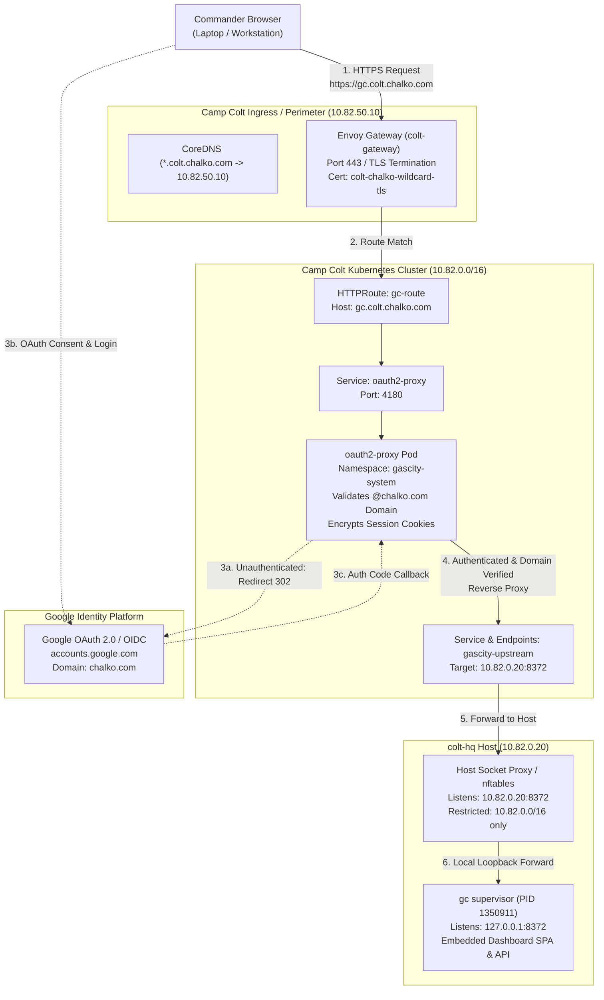

# Implementation Plan: Secure Publishing of Gas City Web Dashboard via Envoy Gateway with Google OAuth

**Status:** Completed (Verified: 2026-10-11)
**Date:** 2026-10-10

---

## 1. Executive Summary

Commander directed the formulation of an implementation plan to securely expose the internal **Gas City web dashboard** to the Commander's workstation browser.

The Gas City web dashboard is an interactive single-page application (SPA) and management interface embedded directly within the Gas City supervisor binary (`gc supervisor run`), running on `colt-hq` (`10.82.0.20:8372`). Currently, this interface is bound strictly to `127.0.0.1:8372` on `colt-hq` and is inaccessible outside the host.

### Strategic Objectives

1. **Secure Ingress URL:** Expose the dashboard under `https://gc.colt.chalko.com` (with alias `https://gascity.colt.chalko.com`).
2. **TLS Termination:** Leverage the existing wildcard certificate `colt-chalko-wildcard-tls` (`*.colt.chalko.com`) on Envoy Gateway (`colt-gateway` in `envoy-gateway-system` @ VIP `10.82.50.10`).
3. **Mandatory Identity & Access Control:** Require Google OAuth authentication strictly restricted to the `@chalko.com` Google Workspace domain, replicating the security posture proven in Grafana.
4. **Zero-Trust Network Perimeter:** Ensure unauthenticated requests cannot access port 8372, and raw port 8372 on `colt-hq` is not exposed openly to untrusted network segments.
5. **GitOps & Declarative IaC:** Implement all cluster configurations through Flux GitOps under `provision/k8s/apps/gascity/` without manual mutating cluster commands.

---

## 2. Architecture & Traffic Flow

### 2.1 Topology Overview



### 2.2 Sequence of Operations

1. **Initial Request:** Commander navigates to `https://gc.colt.chalko.com`.
2. **Perimeter Resolution:** CoreDNS resolves `gc.colt.chalko.com` to `10.82.50.10` via existing wildcard `*.colt.chalko.com` record.
3. **TLS Termination:** Envoy Gateway terminates TLS using secret `colt-chalko-wildcard-tls`.
4. **Authentication Check:** Envoy routes traffic to `oauth2-proxy`. If no valid encrypted session cookie exists:
   - `oauth2-proxy` initiates the OAuth code flow and redirects the browser to `https://accounts.google.com/o/oauth2/v2/auth` with `client_id`, `redirect_uri=https://gc.colt.chalko.com/oauth2/callback`, `hd=chalko.com`, and `prompt=select_account`.
5. **Identity Verification:**
   - Google authenticates the user and returns an authorization code to `https://gc.colt.chalko.com/oauth2/callback`.
   - `oauth2-proxy` exchanges the code for ID and Access Tokens with `oauth2.googleapis.com`.
   - `oauth2-proxy` inspects claims: strictly verifies `email` ends in `@chalko.com` and `hd == "chalko.com"`. Any non-chalko account receives `403 Forbidden`.
6. **Session Establishment:** `oauth2-proxy` sets an encrypted, HTTP-only, Secure SameSite cookie (`_oauth2_proxy`) and redirects Commander to `/`.
7. **Upstream Reverse Proxying:** Valid requests are forwarded via internal ClusterIP service `gascity-upstream` to `colt-hq:8372`.
8. **Dashboard Delivery:** Gas City supervisor serves the SPA HTML/JS/CSS and handles API/WebSocket connections.

---

## 3. Technology Evaluation: Option A vs. Option B

We evaluated two technical patterns for enforcing Google OAuth at the gateway layer.

### 3.1 Option A: Envoy Gateway Native `SecurityPolicy` (OIDC Filter)

Envoy Gateway supports OIDC authentication natively via the `SecurityPolicy` CRD (`gateway.envoyproxy.io/v1alpha1`).

```yaml
apiVersion: gateway.envoyproxy.io/v1alpha1
kind: SecurityPolicy
metadata:
  name: gascity-oidc-policy
  namespace: gascity-system
spec:
  targetRefs:
    - group: gateway.networking.k8s.io
      kind: HTTPRoute
      name: gc-route
  oidc:
    provider:
      issuer: "https://accounts.google.com"
    clientIDRef:
      name: gascity-oauth-secret
    clientSecret:
      name: gascity-oauth-secret
    redirectURL: "https://gc.colt.chalko.com/oauth2/callback"
    scopes:
      - openid
      - email
      - profile
```

#### Evaluation

- **Pros:**
  - In-process filter inside Envoy Gateway; no extra pods or deployment manifests to manage.
  - Zero proxy hops between Envoy and the upstream backend.
- **Cons & Critical Security Risks:**
  - **No Native Domain Restriction:** Envoy Gateway's `spec.oidc.provider` does not support custom query parameters (such as `hd=chalko.com`) during the initial redirect to Google.
  - **Claims Enforcement Gap:** Google's OIDC endpoint will authenticate _any_ valid Google user (including personal `@gmail.com`). Envoy Gateway's `spec.authorization.rules` evaluates JWT claims only when `spec.jwt` is explicitly configured. Because the OIDC filter stores authentication state in an encrypted browser cookie, downstream filters cannot directly validate the ID token claims without complex CEL workarounds.
  - **Vulnerability:** Without strict claim verification, any external individual with a personal Google account would be able to complete OAuth and access the Gas City supervisor dashboard.

---

### 3.2 Option B: Dedicated `oauth2-proxy` in Kubernetes (Recommended)

Deploy a lightweight, highly-hardened `oauth2-proxy` instance inside the `gascity-system` namespace. Envoy Gateway routes `https://gc.colt.chalko.com` to `oauth2-proxy`, which mediates upstream requests to `colt-hq:8372`.

```yaml
args:
  - --http-address=0.0.0.0:4180
  - --upstream=http://gascity-upstream:8372
  - --provider=google
  - --google-hosted-domain=chalko.com
  - --email-domain=chalko.com
  - --cookie-secure=true
  - --cookie-httponly=true
  - --cookie-samesite=lax
  - --cookie-domain=colt.chalko.com
  - --cookie-name=_gc_colt_oauth2
```

#### Evaluation

- **Pros:**
  - **Strict Domain Containment:** Hard-enforces `--google-hosted-domain=chalko.com` and `--email-domain=chalko.com`. Any authentication attempt with an unauthorized domain is immediately rejected with HTTP 403.
  - **Standardized Pattern:** Industry gold-standard reverse authentication proxy for single-page applications and web dashboards.
  - **Full SPA & WebSocket Support:** Seamlessly passes WebSocket traffic, handles token refreshes, supports `/oauth2/sign_out`, and strips sensitive upstream headers.
  - **Audit Logging:** Emits structured JSON access logs identifying the specific Google Workspace email accessing each path.
  - **Minimal Footprint:** Requires ~50MiB RAM and <10m CPU.
- **Cons:**
  - Adds one container workload and Service within the Kubernetes cluster.

### 3.3 Comparative Decision Matrix

| Evaluation Criteria                  | Option A: Envoy Gateway SecurityPolicy      | Option B: Dedicated oauth2-proxy (Recommended)          |
| :----------------------------------- | :------------------------------------------ | :------------------------------------------------------ |
| **Strict `@chalko.com` Enforcement** | ❌ Complex / Risk of `@gmail.com` bypass    | ✅ Native (`--email-domain` + `--google-hosted-domain`) |
| **Session Cookie Management**        | ⚠️ Opaque Envoy cookies; limited controls   | ✅ Configurable AES-256-GCM cookies + refresh           |
| **SPA & WebSocket Proxying**         | ⚠️ Potential session dropouts on WS         | ✅ Full streaming & WebSocket protocol support          |
| **Operational Simplicity**           | ⚠️ Alpha CRD (`v1alpha1`); edge-case syntax | ✅ Highly stable, battle-tested Kubernetes deployment   |
| **Audit Log Visibility**             | ⚠️ Requires Envoy access log parsing        | ✅ Direct user email logged on every HTTP transaction   |
| **Verdict**                          | **REJECTED (Security Posture Risk)**        | **APPROVED (Zero-Trust Compliant)**                     |

---

## 4. Backend Upstream & Zero-Trust Host Hardening

### 4.1 Host Loopback Isolation Analysis

Inspection of `gc supervisor` on `colt-hq` (`10.82.0.20`) reveals that `gc supervisor run` calls `internal/supervisor.reserveLoopbackPort` and listens exclusively on:

```text
tcp LISTEN 0 4096 127.0.0.1:8372 users:(("gc",pid=1350911,fd=8))
```

External TCP connections to `10.82.0.20:8372` from the cluster currently fail with `connection refused`.

### 4.2 Mediated Ingress Bridge on `colt-hq`

To expose port 8372 to the Kubernetes cluster without exposing unauthenticated raw HTTP to external networks or other hypervisor VLANs, we implement a managed host proxy using `systemd-socket-proxyd`:

#### Unit: `/etc/systemd/system/colt-hq-gascity-proxy.socket`

```ini
[Unit]
Description=Gas City Dashboard Cluster Ingress Socket
PartOf=colt-hq-gascity-proxy.service

[Socket]
ListenStream=10.82.0.20:8372
BindIPv6Only=both

[Install]
WantedBy=sockets.target
```

#### Unit: `/etc/systemd/system/colt-hq-gascity-proxy.service`

```ini
[Unit]
Description=Gas City Dashboard Socket Forwarder
After=network.target gascity-supervisor.service
Requires=colt-hq-gascity-proxy.socket

[Service]
Type=notify
ExecStart=/lib/systemd/systemd-socket-proxyd 127.0.0.1:8372
Restart=always
RestartSec=3s
PrivateTmp=true
ProtectSystem=strict
ProtectHome=true

[Install]
WantedBy=multi-user.target
```

#### Host Firewall Containment (`nftables`)

Ensure that only traffic originating from the appliance network (`10.82.0.0/16`) can access port 8372 on `colt-hq`:

```nftables
table inet filter {
    chain input {
        ip saddr 10.82.0.0/16 tcp dport 8372 accept
        tcp dport 8372 drop
    }
}
```

---

## 5. Declarative Manifests Specification

All declarative manifests will be staged under `provision/k8s/apps/gascity/`.

### 5.1 Directory Structure

```text
provision/k8s/apps/gascity/
├── kustomization.yaml
├── namespace.yaml
├── secrets.yaml
├── upstream-service.yaml
├── oauth2-proxy-deployment.yaml
├── oauth2-proxy-service.yaml
└── httproute.yaml
```

### 5.2 Manifest Details

#### `namespace.yaml`

```yaml
apiVersion: v1
kind: Namespace
metadata:
  name: gascity-system
  labels:
    app.kubernetes.io/name: gascity
    app.kubernetes.io/part-of: camp-colt
    colt.chalko.com/tier: management
```

#### `secrets.yaml` (ExternalSecret pulling from HashCorp Vault)

```yaml
apiVersion: external-secrets.io/v1beta1
kind: ExternalSecret
metadata:
  name: gascity-oauth-secret
  namespace: gascity-system
spec:
  refreshInterval: "1h"
  secretStoreRef:
    name: colt-vault
    kind: ClusterSecretStore
  target:
    name: gascity-oauth-secret
    creationPolicy: Owner
    deletionPolicy: Retain
  data:
    - secretKey: client-id
      remoteRef:
        key: secret/data/colt/monitoring/grafana
        property: google_client_id
    - secretKey: client-secret
      remoteRef:
        key: secret/data/colt/monitoring/grafana
        property: google_client_secret
    - secretKey: cookie-secret
      remoteRef:
        key: secret/data/colt/gascity/oauth
        property: cookie_secret
```

_(Note: Can share the Google OAuth Client ID & Secret from `colt/monitoring/grafana` or use a dedicated entry in `colt/gascity/oauth` once authorized redirect URIs are configured)._

#### `upstream-service.yaml` (Headless Service + Static Endpoints pointing to `colt-hq`)

```yaml
apiVersion: v1
kind: Service
metadata:
  name: gascity-upstream
  namespace: gascity-system
spec:
  type: ClusterIP
  ports:
    - name: http
      port: 8372
      targetPort: 8372
---
apiVersion: v1
kind: Endpoints
metadata:
  name: gascity-upstream
  namespace: gascity-system
subsets:
  - addresses:
      - ip: 10.82.0.20
    ports:
      - name: http
        port: 8372
```

#### `oauth2-proxy-deployment.yaml`

```yaml
apiVersion: apps/v1
kind: Deployment
metadata:
  name: oauth2-proxy
  namespace: gascity-system
  labels:
    app.kubernetes.io/name: oauth2-proxy
    app.kubernetes.io/component: authentication
spec:
  replicas: 1
  selector:
    matchLabels:
      app.kubernetes.io/name: oauth2-proxy
  template:
    metadata:
      labels:
        app.kubernetes.io/name: oauth2-proxy
    spec:
      securityContext:
        runAsNonRoot: true
        runAsUser: 65534
        fsGroup: 65534
      containers:
        - name: oauth2-proxy
          image: quay.io/oauth2-proxy/oauth2-proxy:v7.6.0
          args:
            - --http-address=0.0.0.0:4180
            - --upstream=http://gascity-upstream.gascity-system.svc.cluster.local:8372
            - --provider=google
            - --google-hosted-domain=chalko.com
            - --email-domain=chalko.com
            - --prompt=select_account
            - --cookie-secure=true
            - --cookie-httponly=true
            - --cookie-samesite=lax
            - --cookie-domain=colt.chalko.com
            - --cookie-name=_gc_colt_oauth2
            - --set-xauthrequest=true
            - --pass-host-header=true
            - --reverse-proxy=true
            - --whitelist-domain=.colt.chalko.com
          env:
            - name: OAUTH2_PROXY_CLIENT_ID
              valueFrom:
                secretKeyRef:
                  name: gascity-oauth-secret
                  key: client-id
            - name: OAUTH2_PROXY_CLIENT_SECRET
              valueFrom:
                secretKeyRef:
                  name: gascity-oauth-secret
                  key: client-secret
            - name: OAUTH2_PROXY_COOKIE_SECRET
              valueFrom:
                secretKeyRef:
                  name: gascity-oauth-secret
                  key: cookie-secret
          ports:
            - containerPort: 4180
              name: http
          livenessProbe:
            httpGet:
              path: /ping
              port: 4180
            initialDelaySeconds: 5
            periodSeconds: 10
          readinessProbe:
            httpGet:
              path: /ping
              port: 4180
            initialDelaySeconds: 3
            periodSeconds: 5
          resources:
            requests:
              cpu: 10m
              memory: 32Mi
            limits:
              cpu: 200m
              memory: 128Mi
```

#### `oauth2-proxy-service.yaml`

```yaml
apiVersion: v1
kind: Service
metadata:
  name: oauth2-proxy
  namespace: gascity-system
spec:
  type: ClusterIP
  selector:
    app.kubernetes.io/name: oauth2-proxy
  ports:
    - name: http
      port: 4180
      targetPort: 4180
```

#### `httproute.yaml`

```yaml
apiVersion: gateway.networking.k8s.io/v1
kind: HTTPRoute
metadata:
  name: gc-route
  namespace: gascity-system
spec:
  parentRefs:
    - name: colt-gateway
      namespace: envoy-gateway-system
  hostnames:
    - "gc.colt.chalko.com"
    - "gascity.colt.chalko.com"
  rules:
    - matches:
        - path:
            type: PathPrefix
            value: /
      timeouts:
        request: 300s
        backendRequest: 300s
      backendRefs:
        - name: oauth2-proxy
          port: 4180
```

#### `kustomization.yaml`

```yaml
apiVersion: kustomize.config.k8s.io/v1beta1
kind: Kustomization
resources:
  - namespace.yaml
  - secrets.yaml
  - upstream-service.yaml
  - oauth2-proxy-deployment.yaml
  - oauth2-proxy-service.yaml
  - httproute.yaml
```

---

## 6. External Prerequisites & Configuration

### 6.1 Google Cloud OAuth Configuration & CLI Analysis

#### Standard OAuth 2.0 Client CLI Limitation

For standard Google Cloud OAuth 2.0 Web Client credentials (under **APIs & Services** > **Credentials**), Google does **not** provide a direct `gcloud` CLI command to mutate `redirect_uris` or `javascript_origins`. This is an intentional security design by Google to prevent programmatic tampering of OAuth consent callbacks on standard web applications.
_(Note: `gcloud iam oauth-clients update` is strictly reserved for Workforce Identity Federation pools and will reject standard project client IDs)._

#### Required Configuration Steps

1. Determine active project or open the credentials page directly:

   ```bash
   # Print direct console URL for active project
   echo "https://console.cloud.google.com/apis/credentials?project=$(gcloud config get-value project 2>/dev/null || echo '<PROJECT_ID>')"
   ```

2. In **APIs & Services** > **Credentials**, click the existing OAuth 2.0 Web Client (used by Grafana / Camp Colt).
3. Under **Authorized JavaScript origins**, add:
   - `https://gc.colt.chalko.com`
   - `https://gascity.colt.chalko.com`
4. Under **Authorized redirect URIs**, add:
   - `https://gc.colt.chalko.com/oauth2/callback`
   - `https://gascity.colt.chalko.com/oauth2/callback`
5. Click **Save**. _(Note: Google propagate changes within 5 minutes)._

### 6.2 HashCorp Vault Secrets Provisioning (Native Entropy Generation)

HashCorp Vault provides a native random generation system tool (`/sys/tools/random`) that produces cryptographically secure entropy directly on the platform without requiring external scripts:

```bash
# 1. Generate 32-byte base64-encoded random secret natively using HashCorp Vault
COOKIE_SECRET=$(vault write -format=json sys/tools/random/32 format=base64 | jq -r .data.random_bytes)

# 2. Store directly in Vault KV store
vault kv put secret/colt/gascity/oauth \
  cookie_secret="$COOKIE_SECRET"

# 3. Verify secret existence safely (metadata only — never dump plaintext values to stdout/logs)
vault kv metadata get secret/colt/gascity/oauth
```

_(Alternatively, in Terraform/OpenTofu via HashCorp `hashicorp/random` provider: `resource "random_bytes" "gc_cookie_secret" { length = 32 }`)._

### 6.3 CoreDNS / Local DNS Verification

CoreDNS in `provision/k8s/apps/dns/configmap.yaml` already defines:

```zone
* IN A 10.82.50.10
```

This automatically routes `gc.colt.chalko.com` and `gascity.colt.chalko.com` to the Envoy Gateway VIP (`10.82.50.10`). No new DNS zone edits are required.

---

## 7. Phased Implementation Roadmap

| Phase | Milestone                      | Action Items                                                                                            | Verification Gate                                                               |
| :---: | :----------------------------- | :------------------------------------------------------------------------------------------------------ | :------------------------------------------------------------------------------ |
| **1** | **Host Proxy on `colt-hq`**    | Deploy `colt-hq-gascity-proxy.socket` & `.service`. Enforce `nftables` inbound rule for `10.82.0.0/16`. | `curl -I http://10.82.0.20:8372` from Kubernetes worker node succeeds.          |
| **2** | **External Prerequisites**     | Register redirect URIs in Google Cloud Console. Store `cookie_secret` in Vault.                         | Secret verified via `vault kv get secret/colt/gascity/oauth`.                   |
| **3** | **GitOps Manifest Authoring**  | Create `provision/k8s/apps/gascity/` directory. Add `apps/gascity` to root `kustomization.yaml`.        | `kubectl kustomize provision/k8s` compiles without syntax error.                |
| **4** | **Flux GitOps Reconciliation** | Commit & push to `main`. Trigger `flux reconcile kustomization cluster --with-source`.                  | Pod `oauth2-proxy` enters `Running` state; `HTTPRoute` status `Accepted: True`. |
| **5** | **Live End-to-End Validation** | Perform unauthenticated, unauthorized domain, and authorized domain tests from Commander's workstation. | Clean login to Gas City SPA; full bead graph and supervisor telemetry visible.  |

---

## 8. Verification & Validation Protocol

Executing sysadmin will run the following acceptance tests:

1. **Unauthenticated Access Probe:**

   ```bash
   curl -k -I https://gc.colt.chalko.com
   ```

   _Expected:_ HTTP `302 Found` with `Location: https://accounts.google.com/o/oauth2/v2/auth?...`

2. **Negative Domain Authorization Test:**

   - Attempt login in browser using a personal `@gmail.com` account.
   - _Expected:_ HTTP `403 Forbidden` from `oauth2-proxy` with message `Access Denied: Invalid email domain`.

3. **Authorized Domain Test:**

   - Log in using an authorized account (`*@chalko.com`).
   - _Expected:_
     - Browser receives `_gc_colt_oauth2` cookie.
     - HTTP `200 OK` returned for `/`.
     - Gas City Dashboard SPA renders city status, beads, and session logs.

4. **SPA & WebSocket Stream Validation:**

   - Inspect browser DevTools network tab.
   - Verify WebSocket connections (`/v0/events` or SSE streams) remain established without disconnections.

5. **Direct Perimeter Bypass Check:**
   - Attempt curl from external network or unauthorized subnet to `10.82.0.20:8372`.
   - _Expected:_ Connection blocked / dropped by firewall.

---

## 9. Rollback Runbook

If any regression occurs or access must be revoked immediately:

1. **Immediate Ingress Teardown:**
   Delete the HTTPRoute to sever external exposure instantly:

   ```bash
   KUBECONFIG="$REPO_ROOT/colt-kubeconfig" kubectl delete httproute gc-route -n gascity-system
   ```

2. **GitOps Rollback:**
   - Remove `apps/gascity` from `provision/k8s/kustomization.yaml`.
   - Push commit to `main`.
   - Reconcile Flux: `flux reconcile kustomization cluster --with-source`.
3. **Host Socket Teardown:**
   On `colt-hq`:

   ```bash
   systemctl stop colt-hq-gascity-proxy.socket colt-hq-gascity-proxy.service
   systemctl disable colt-hq-gascity-proxy.socket colt-hq-gascity-proxy.service
   ```

---

## 10. Conclusion & Staff Recommendation

Deploying **Option B (`oauth2-proxy`)** upstream of Gas City behind Envoy Gateway provides the strongest zero-trust security posture, ensuring that:

- Domain isolation (`chalko.com`) is strictly enforced at the application proxy boundary.
- Unauthenticated access to Gas City supervisor APIs is impossible.
- Integration uses existing wildcard TLS certificates and ingress infrastructure without modifying the core `gc` binary.

Sysadmin requests Commander approval to proceed with Phase 1 through Phase 5 upon review of this plan.
