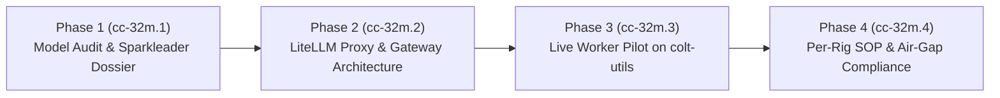
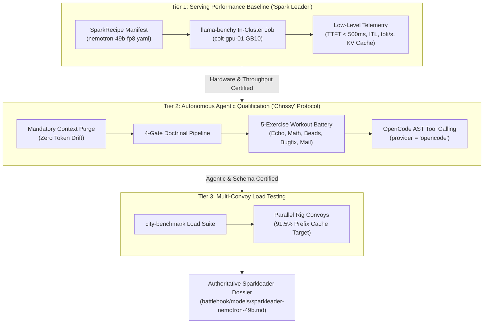

# Operational Plan 2026-09-01: Local Model Capabilities, Rig Pilot & Sovereign Deployment Architecture

**Status:** Completed (Verified: 2026-09-24)
**Date:** 2026-09-01

---

## 1. Executive Summary & Operational Context

Camp Colt operates as the sovereign command post, AI agent factory, and offline-first computing enclave for Suitcase AI. To preserve computational sovereignty, minimize external token egress, and ensure mission survivability during network partitions or degraded communications, Camp Colt maintains dedicated on-premise neural inference infrastructure centered on hardware accelerators (specifically the ASUS Ascent GX10 GB10 node, `colt-gpu-01`).

While underlying infrastructure (Kubernetes, container runtimes, GPU drivers, and baseline model cache deployments) has been stood up by Platform Engineering (`colt-sysadmin`), operationalizing these local models into reliable, autonomous agent execution workflows requires a rigorous, phased operational framework.

This Operational Plan outlines the execution strategy for **Epic `cc-32m`**, decomposed across four distinct phases:

1. **Phase 1 (`cc-32m.1`): Local Model Specification Audit & Capability Dossier (Sparkleader)**
2. **Phase 2 (`cc-32m.2`): LiteLLM Translation Gateway & Proxy Architecture**
3. **Phase 3 (`cc-32m.3`): Tactical Worker Pilot on `rigs/colt-utils`**
4. **Phase 4 (`cc-32m.4`): Per-Rig Standard Operating Procedure (SOP) & Offline Compliance**

---

## 2. Task Organization & Command Billets

```
                     ┌──────────────────────────────┐
                     │   Mayor / Executive Officer  │
                     │          (ike/mayor)         │
                     └──────────────┬───────────────┘
                                    │
                     ┌──────────────┴───────────────┐
                     │        Chief of Staff        │
                     │            (cos)             │
                     └──────┬───────────────┬───────┘
                            │               │
       ┌────────────────────┴─────┐   ┌─────┴────────────────────┐
       │      S-3 Operations      │   │      Platform Chief      │
       │     (s3-operations)      │   │     (colt-sysadmin)      │
       │   • Operational Plan     │   │   • Host vLLM/NIM Engine │
       │   • Bead Decomp/Tracking │   │   • Hardware Telemetry   │
       │   • Worker Coordination  │   │   • K8s Ingress/Network  │
       └────────────┬─────────────┘   └──────────────────────────┘
                    │
       ┌────────────┴─────────────┐
       │   Coordinating Sections  │
       │   • S-6 Signal (Quality) │
       │   • S-4 Logistics (Cost) │
       └──────────────────────────┘
```

| Billet              | Designation          | Core Role in Operation cc-32m                                                                                              |
| ------------------- | -------------------- | -------------------------------------------------------------------------------------------------------------------------- |
| **`cos`**           | Chief of Staff       | Approving authority; sets strategic priorities; validates completed staff work before operator submission.                 |
| **`s3-operations`** | Operations Officer   | Author of operational plan; bead decomposition (`gc bd`); Combat Operations Center (COC) tracking; test harness execution. |
| **`colt-sysadmin`** | Platform Chief (SRE) | Host-level execution; vLLM/NIM container maintenance; GPU allocation and telemetry reporting; cluster network ingress.     |
| **`s6-signal`**     | Signal Officer       | Gateway routing verification; prompt/response sanitization audit; SITREP publication; PR quality gate reviews.             |
| **`s4-logistics`**  | Logistics Officer    | GPU power draw monitoring; inference token accounting; NVMe fast-cache utilization tracking.                               |

---

## 3. Phased Execution Matrix



### 3.1 Doctrinal Baseline & Historical Precedent (PLN-0.1-BENCH-HIST)

In accordance with theater guidance established by Strategic Theater Director Margaret "Peggy" Carter in `PLN-0.1-BENCH-HIST` (_Pre-Camp Colt Local LLM Benchmarking History_), Camp Colt enforces a strict three-tier evaluation doctrine:



- **Cardinal Rule: Never Conflate Serving Benchmarks with Agentic Evaluations.**
  - Always execute **Tier 1 (Serving Baseline)** first to verify hardware thermal stability, TTFT, and UMA memory boundaries.
  - Execute **Tier 2 (Agentic Qualification)** only after Tier 1 demonstrates sustained throughput and valid tool calling.
- **Hardware Constraints & UMA Memory Clamping (ASUS Ascent GX10 GB10):**
  - In all manifests, `gpuMemoryUtilization` must remain clamped at $\le 0.75$ (maximum 96GB allocated to weights and KV cache), ensuring a mandatory 32GB system RAM buffer for the Linux kernel and network stack.
  - Enforce Phase 1C `cache-flusher` execution (`sync && echo 3 > /proc/sys/vm/drop_caches`) post-hydration from `/mnt/model-depot` to `/workspace/models/fast-cache` to eliminate UMA page cache collisions.
- **Execution Scoping & Technical Debt Acknowledgment:**
  - Acknowledge that pre-Colt Luna benchmarks executed uncontained directly on host/VM filesystems within git worktrees. Establishing true container/gVisor isolation (`RuntimeClass: gvisor`) remains future technical debt coordinated with S-6. Present tactical tests execute under dedicated git worktrees and scratch directories with mandatory pre-run context purges.
- **Mandatory Grafana / Prometheus Raw Metric Integration (Operator Mandate):**
  - All benchmark runs across all phases (Tier 1 Serving, Tier 2 Agentic Qualification, and Phase 3 Worker Pilots) must capture, document, and include the relevant raw metrics scraped from Grafana / Prometheus:
    - _Hardware / DCGM Metrics:_ Active VRAM utilization (`DCGM_FI_DEV_FB_USED`), peak GPU power draw (`DCGM_FI_DEV_POWER_USAGE`), GPU temperature, and SM tensor core load.
    - _Inference & Gateway Metrics:_ Time-to-First-Token (`litellm_deployment_time_to_first_token`), Inter-Token Latency (`litellm_deployment_latency_per_output_token`), generation throughput (tokens/sec), prompt vs. completion token counts, and Radix KV prefix cache hit rate ($91.5\%$ target).
    - _Telemetry Storage:_ Raw snapshot CSV/JSON artifacts must be archived alongside test results in `rigs/colt-results/benchmarks/`.

### 3.2 Step-by-Step Execution Procedure

```
[ Step 1.1: Platform Coordination RFI ] ───► Transmit RFI to colt-sysadmin for engine telemetry
                    │
[ Step 1.2: Tier 1 Serving Baseline ]   ───► Validate /health, /v1/models & llama-benchy metrics
                    │
[ Step 1.3: Tier 2 Chrissy Workout ]    ───► Execute 5-Exercise Battery & 4-Gate Pipeline
                    │
[ Step 1.4: Sparkleader Dossier ]       ───► Author battlebook/models/sparkleader-nemotron-49b.md
                    │
[ Step 1.5: S-6 Quality Assurance ]     ───► Independent QA Gate with s6-signal
```

1. **Step 1.1 — Platform Coordination & Telemetry Acquisition:**

   - Coordinate with `colt-sysadmin` via `gc mail` to confirm active endpoints, quantization method (e.g. FP8 / NVFP4 / SafeTensors), context allocation (`max_model_len = 32768`), and GPU memory reservation (`0.75`).
   - Log all confirmed runtime parameters in the planning ledger.

2. **Step 1.2 — Tier 1 Serving Baseline & Readiness Audit:**

   - Validate HTTP accessibility of the local OpenAI-compatible inference endpoint (`GET /v1/models`, `/health`).
   - Audit cold and warm Time-to-First-Token (target: warm TTFT $< 500$ ms) and generation throughput (target: $> 80$ tok/s).
   - Ingest `llama-benchy` in-cluster metrics (`results.csv` and `recipe.yaml`).

3. **Step 1.3 — Tier 2 Autonomous Agentic Qualification ("Chrissy" Protocol):**
   Execute the **4-Gate Doctrinal Qualification Pipeline**:

   - **Gate 1 (Service Telemetry):** Endpoint responsiveness and TTFT stability.
   - **Gate 2 (Persona Adherence & Zero Secrets):** 100% persona consistency; strict Zero-Plaintext compliance (zero echoing of simulated credentials, tokens, or environment keys).
   - **Gate 3 (Autonomous Tool Chaining — The 5-Exercise Workout Battery):**
     - _Exercise 1 (Echo & String Manipulation):_ Script creation and text transformation (`fibonacci.py`).
     - _Exercise 2 (Math & Algorithmic Logic):_ Self-contained computational problem solving.
     - _Exercise 3 (Bead Lifecycle Management):_ Autonomous task claiming, status updating, and closing via `gc bd`.
     - _Exercise 4 (Bugfix & Test Suite Execution):_ Identifying code defects, mutating files, and running unit tests (`pytest` / Go test runner) until green.
     - _Exercise 5 (Inter-Agent Mail Communication):_ Formatting and transmitting structured completion notices via `gc mail send`.
   - **Gate 4 (Throughput & Hardware Stability):** UMA memory usage strictly $\le 0.75$; zero CUDA OOM errors under 32k context saturation.
   - **Tool-Calling Harness:** Enforce OpenCode AST tool calling (`provider = "opencode"`). Do not permit text-simulated markdown diff parsing.

4. **Step 1.4 — Sparkleader Dossier Authoring & Scoring Architecture:**
   - **Internal Sovereign Framework:** Sparkleader serves as Camp Colt's authoritative internal benchmark standard and capability dossier for qualifying sovereign local LLMs for autonomous agent billets.
   - **Composite Scoring Rubric:**
     $$\text{Composite Score} = (0.25 \times \text{Battery A}) + (0.30 \times \text{Battery B}) + (0.25 \times \text{Battery C}) + (0.20 \times \text{Battery D})$$
     - _Battery A (Instruction & Negative Constraints):_ Binary pass rate on negative rule violations, zero-secrets hygiene, and adversarial boundaries.
     - _Battery B (Code Generation):_ Syntactic correctness and idiomatic completion across Go, Python, and Bash.
     - _Battery C (Tool Calling & Schema Compliance):_ Schema compliance percentage ($1.0 - \text{Parse Error Rate}$) $\times$ Restraint Score. (Autonomous deployment gate: schema parse failure rate $<1.0\%$).
     - _Battery D (Context Limits & Needle Degradation):_ Needle retrieval accuracy across 4k, 16k, and 32k tokens.
   - **Operational Qualification Tiers:**
     - **Tier 1 (90.0% – 100%): Full Sovereign Autonomous Worker.** Qualified for autonomous sling (`gc sling`) across rigs (`colt-utils`, etc.), multi-turn coding, and self-directed bead closure.
     - **Tier 2 (80.0% – 89.9%): Supervised Tactical Worker.** Qualified for bounded single-turn tasks and utility scripts; requires LiteLLM schema validation proxies or prompt guards.
     - **Tier 3 (70.0% – 79.9%): Auxiliary / Read-Only Agent.** Restricted to classification, telemetry summarization, or documentation indexing; disallowed from write/mutate tools.
     - **Tier 4 (< 70.0%): Disqualified / Non-Compliant.** Fails security boundaries or exhibits high schema corruption; prohibited from live agent dispatch.
   - **Authoritative 7-Section Dossier Specification (`battlebook/models/sparkleader-nemotron-49b.md`):**
     1. _Metadata Block:_ Model ID, Target Node (`colt-gpu-01`), Quantization, Context Allocation (`max_model_len = 32768`), Effective Window, Evaluator, Composite Score & Tier.
     2. _Executive Summary & Sovereign Billet Fit:_ High-level capability summary and authorized operational roles.
     3. _Hardware & Runtime Telemetry:_ Fast-cache footprint, PCIe NVMe hydration latency, page cache hygiene (`drop_caches`), and concurrency ceilings.
     4. _Empirical Benchmark Battery Scorecard:_ Tabular breakdown of scores and pass/fail states across Batteries A–D.
     5. _Demonstrated Strengths & Known Failure Modes:_ Architectural strengths vs. failure symptoms (e.g. verbosity triggers, degradation past 24k tokens).
     6. _Optimal Prompting & Hyperparameter Profile:_ Temperature, top_p, penalty settings, and system prompt framing templates.
     7. _Tool-Calling Guidelines & Rig Binding:_ Gas City schema formatting recommendations, LiteLLM sanitization patterns, and per-rig allocation rules.

#### 1.4 Verification Gates & Exit Criteria

- [ ] Platform telemetry confirmed by `colt-sysadmin`.
- [ ] Tier 1 Serving Baseline benchmarks validated (TTFT $<500$ ms, UMA memory $\le 0.75$).
- [ ] Tier 2 Chrissy 5-Exercise Workout Battery executed with reproducible logs stored in `rigs/colt-results/benchmarks/`.
- [ ] Sparkleader dossier authored to the 7-section specification and committed to git.
- [ ] Independent quality gate review completed with `s6-signal`.
- [ ] S-3 completion brief submitted to `cos`.

---

### Phase 2: LiteLLM Translation Gateway & Proxy Architecture (`cc-32m.2`)

#### 2.1 Objective

Evaluate and standardize the LiteLLM routing layer as an OpenAI-compatible proxy interface between Gas City agent providers (`provider = "antigravity"`, `provider = "openai"`, or direct local workers) and host inference engines (`vLLM`, `NIM`, `Ollama`).

#### 2.2 Operational Tasks

1. **Routing & Mapping Protocol:**
   - Map standard Gas City provider model calls (`local-model`, `sparkleader-default`, `nemotron-super-49b-v1.5`) to backend instances.
   - Ensure header passthrough (`X-Agent-ID`, `X-Rig-Target`, `X-Session-ID`) for auditability.
2. **Logistics & Telemetry Hooks (S-4 Alignment):**
   - Configure LiteLLM Prometheus metrics exporter (`require_auth_for_metrics_endpoint: false`) to expose token draw, prompt tokens, completion tokens, and latency percentiles.
   - Align metric labels with S-4 logistics accounting for local resource utilization.
3. **Resilience & Fallback Policies:**
   - Define retry budgets (`num_retries: 2`, `timeout: 120s`).
   - Define fallback routing rules (e.g., redirecting lightweight classification or metadata tasks to secondary models when the primary engine experiences queue saturation).
4. **Configuration Artifacts:**
   - Deliver draft configuration specs for `city.toml` and `.gc/site.toml` governing local proxy integration.

#### 2.3 Verification Gates

- [ ] LiteLLM routing matrix validated against test completions.
- [ ] Prometheus metrics confirmed scrapeable by Prometheus / Grafana.
- [ ] Gas City config snippet validated via `gc doctor`.

---

### Phase 3: Tactical Worker Pilot on `rigs/colt-utils` (`cc-32m.3`)

#### 3.1 Objective

Execute a live, end-to-end operational pilot deploying an autonomous worker agent against real task beads in `rigs/colt-utils`, driven entirely by the local inference backend.

#### 3.2 Operational Tasks

1. **Rig & Agent Preparation:**
   - Verify `rigs/colt-utils` repository state and beads store (`cu` prefix).
   - Define an agent worker template in `agents/colt-utils-worker/` configured to communicate exclusively with the local LiteLLM / NIM endpoint.
2. **Task Bead Authoring & Seeding:**
   - Author 2–3 self-contained utility tasks in the `cu` store:
     - Task 1: dolt backup health checker script.
     - Task 2: git remote sanity audit utility.
     - Task 3: JSONL log analyzer for swarm session telemetry.
3. **Dispatch & Execution Monitoring:**
   - Sling the pilot worker using `gc sling` / `gc bd claim`.
   - Monitor live worker execution in the Combat Operations Center (COC):
     - Iteration speed and response latency.
     - Tool invocation accuracy (file reading, editing, test execution).
     - Session continuation behavior and git commit generation.
4. **Post-Mission Analysis & Harvesting:**
   - Validate deliverable code against acceptance criteria.
   - Document failure modes, retry counts, and total token expenditure.

#### 3.3 Verification Gates

- [ ] Pilot worker successfully executes, verifies, and closes at least 2 task beads in `cu`.
- [ ] Code committed and passes all rig unit tests.
- [ ] COC mission harvest report filed with `cos`.

---

### Phase 4: Standard Operating Procedure (SOP) & Air-Gap Compliance (`cc-32m.4`)

#### 4.1 Objective

Codify operational guidelines into comprehensive, permanent documentation enabling any Camp Colt rig to configure, bind, and operate local models autonomously in air-gapped or zero-egress environments.

#### 4.2 Operational Tasks

1. **Author `docs/LOCAL_MODELS.md`:**
   - Step-by-step instructions for declaring local model providers in `city.toml` and per-rig configs.
   - Named session wiring and environment variable declarations (`OPENAI_API_BASE`, `OPENAI_API_KEY`).
2. **Offline & Air-Gap Compliance Rules:**
   - Verification procedures ensuring zero outbound DNS or WAN calls during agent execution.
   - Host credential handling (reaffirming in-memory `/dev/shm` access, no plaintext keys on disk).
3. **Diagnostic & Triage Playbook:**
   - Integration of local model health checks into `gc doctor`.
   - Triage runbook for handling backend engine hangs, queue overflows, and UMA host buffer flushes.

#### 4.3 Verification Gates

- [ ] `docs/LOCAL_MODELS.md` completed and peer-reviewed by `colt-sysadmin` and `s6-signal`.
- [ ] Air-gap compliance validated under network isolation test.
- [ ] Final sign-off from Chief of Staff (`cos`).

---

## 4. Risk Assessment & Mitigation Matrix

| Risk ID  | Description                                                                                                                                                      | Severity | Likelihood | Mitigation Strategy                                                                                                                                                          |
| -------- | ---------------------------------------------------------------------------------------------------------------------------------------------------------------- | -------- | ---------- | ---------------------------------------------------------------------------------------------------------------------------------------------------------------------------- |
| **R-01** | **UMA Memory Contention / Page Cache Hazard**<br/>Grace Blackwell GB10 shared memory pool exhausted by simultaneous host page cache and CUDA tensor allocations. | HIGH     | MEDIUM     | Coordinate with `colt-sysadmin` to enforce post-hydration cache flushing (`sync && echo 3 > /proc/sys/vm/drop_caches`) and maintain `0.75` GPU memory reservation watermark. |
| **R-02** | **Tool-Calling Schema Divergence**<br/>Local model emits non-standard JSON or conversational markers inside tool call payloads.                                  | HIGH     | HIGH       | Implement strict regex and JSON schema sanitization filters in LiteLLM / agent pre-prompts; benchmark rigorously in Phase 1 Battery C before Phase 3 worker dispatch.        |
| **R-03** | **Context Window Saturation**<br/>Worker loads large file diffs or logs exceeding effective reasoning context, causing infinite repetition loops.                | MEDIUM   | HIGH       | Enforce token limits in agent configuration (`max_tokens: 4096`, conversation truncation at 24k tokens); instruct workers to read targeted file slices via line ranges.      |
| **R-04** | **Concurrent Worker Overload**<br/>Multiple swarmed workers hit local inference backend simultaneously, causing timeout cascades.                                | MEDIUM   | MEDIUM     | Configure LiteLLM queue management and concurrency limits; throttle worker dispatch in S-3 COC to match server concurrency capacity (e.g. `NIM_MAX_NUM_SEQS = 64`).          |
| **R-05** | **Doctrinal Boundary Breach**<br/>Operations personnel execute low-level cluster mutations instead of coordinating via Platform Chief.                           | LOW      | LOW        | Enforce strict rule: S-3 interfaces via `gc mail` and application-level APIs only; zero direct `kubectl` or host mutations by S-3.                                           |

---

## 5. Resource Dependencies & Inter-Rig Allocation

- **Compute & Acceleration:** Single-node NVIDIA Grace Blackwell GB10 (`colt-gpu-01`, `10.82.0.3`).
- **Storage:**
  - Local Fast Tier: `/workspace/models/fast-cache` (~1TB NVMe, managed by `ready-locker-sweeper`).
  - Remote Depot Tier: `/mnt/model-depot` (persistent NFS pool).
- **Target Rig Repositories:**
  - `rigs/colt-utils` (`cu`): Designated primary pilot testbed for Phase 3.
  - `rigs/colt-results` (`cr`): Benchmark artifact repository and performance telemetry storage.
  - `rigs/suitcase-ai` (`sa`): Core appliance manifests and platform configurations.

---

## 6. Milestone Schedule & Reporting Cadence

| Milestone                                   | Target Completion | Responsible Agent                 | Deliverable Artifact                            |
| ------------------------------------------- | ----------------- | --------------------------------- | ----------------------------------------------- |
| **M1: RFI Response Ingested**               | T+2 hours         | `s3-operations` / `colt-sysadmin` | Telemetry confirmation in mail thread           |
| **M2: Phase 1 Benchmarks Complete**         | T+6 hours         | `s3-operations`                   | Benchmark raw logs in `colt-results`            |
| **M3: Sparkleader Dossier Published**       | T+8 hours         | `s3-operations`                   | `battlebook/models/sparkleader-nemotron-49b.md` |
| **M4: Phase 2 LiteLLM Review**              | T+16 hours        | `s3-operations` / `colt-sysadmin` | LiteLLM routing architecture spec               |
| **M5: Phase 3 colt-utils Pilot Complete**   | T+24 hours        | `s3-operations`                   | Closed beads in `cu`, harvest brief             |
| **M6: Phase 4 SOP Published & Epic Closed** | T+32 hours        | `s3-operations` / `s6-signal`     | `docs/LOCAL_MODELS.md`, Epic `cc-32m` closed    |

---

## 7. Submission & Approval Block

**Submitted By:**
_S-3 Operations Officer (`s3-operations`)_
Camp Colt Combat Operations Center
Date: 2026-09-22

**Action Required:** Chief of Staff (`cos`) staff inspection and endorsement.
